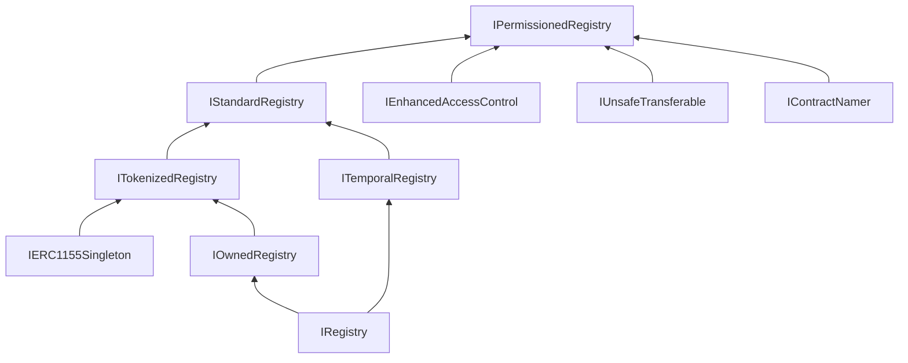
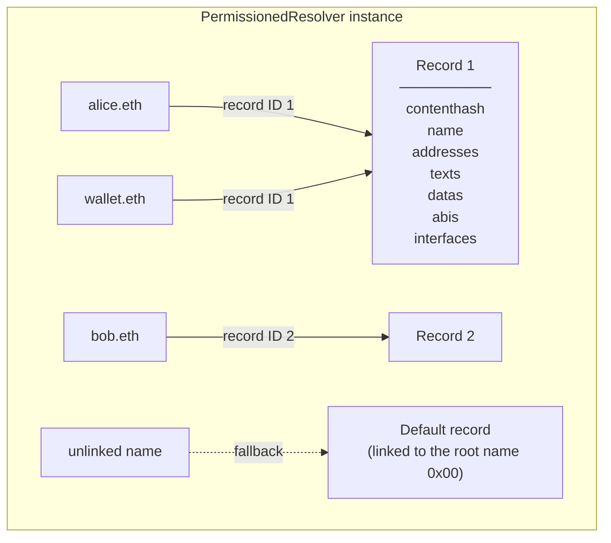
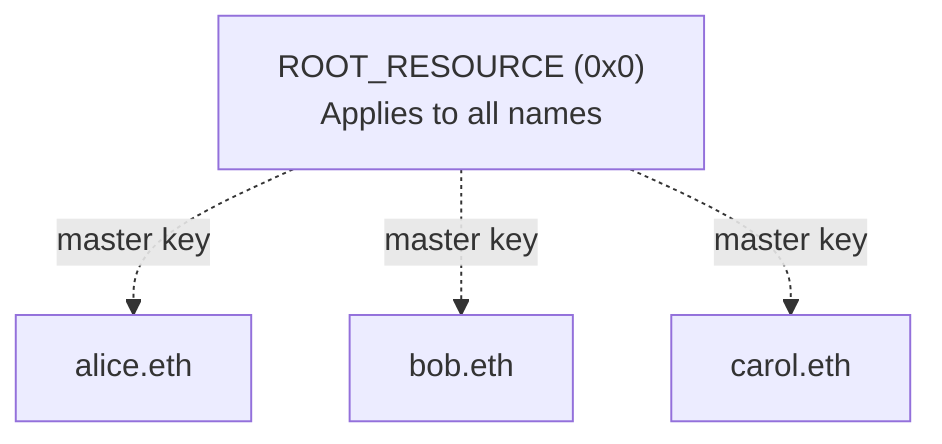
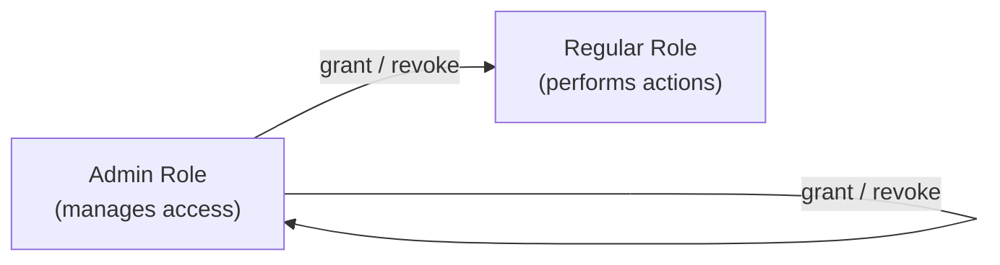
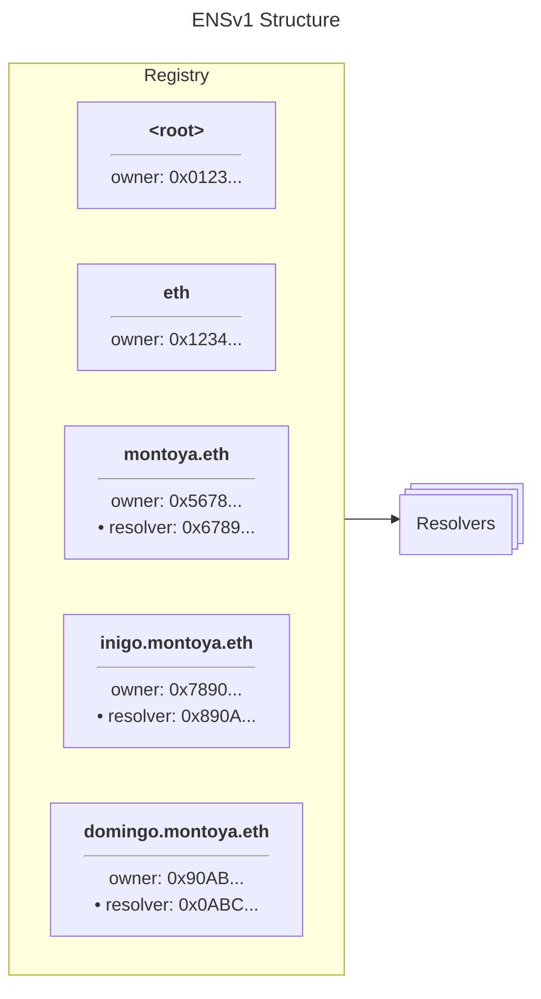
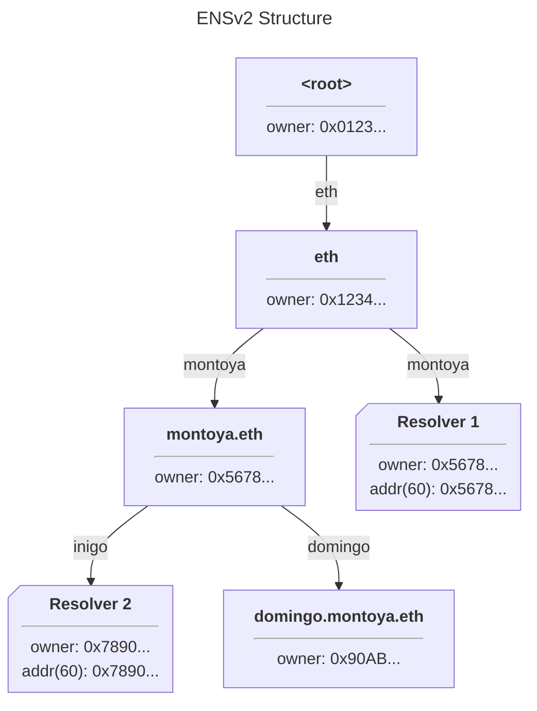
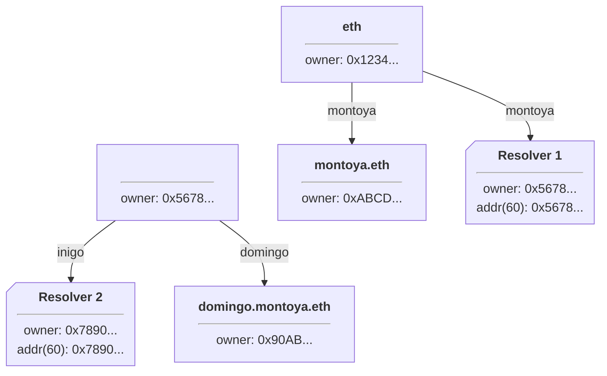
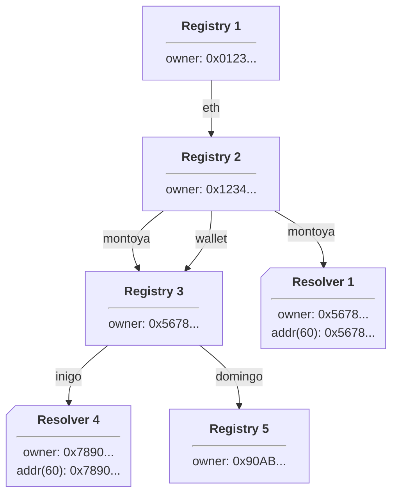

# Docs study: ensv2 (docs agent, started 01:27 IST)

## [01:33] ENS docs full text (https://docs.ens.domains/llms-full.txt, 1.8MB, fetched via curl; vocs SPA so .md paths return HTML shell). Confidence HIGH on text; addresses see below
NOTE: pages dumped verbatim below: Issuing Subnames, Registry Template, Permissioned Resolver, Enhanced Access Control, For App Developers, Registry Hierarchy (llms-full lines 9836-9938, 9573-9835, 8497-9399, 5574-5942, 9939-10427, 9400-9572). Deployments page uses a dynamic <ENSv2Deployments chain="sepolia"/> component so addresses are NOT in the text; see address section.

-------- llms-full lines 9836,9938 --------
## Issuing Subnames in ENSv2

An ENSv2 name can serve subnames through its resolver, its subregistry, or both. Choose the setup based on who should own the subnames and who should update their records.

### Subnames as Resolver Records

If you manage every subname, you can keep their records in one [Permissioned Resolver](/ensv2/permissioned-resolver). Set that resolver on your parent name, such as `wallet.eth`, and write records for full names such as `alice.wallet.eth` and `bob.wallet.eth`.

The [Universal Resolver](/resolvers/universal) finds the parent's resolver and passes it the full name through [wildcard resolution](/ensip/10). No subregistry or subname token is required. These are onchain records, even though there is no token for each subname.

The resolver's role holders control the records. Giving Alice an address record does not give her ownership of `alice.wallet.eth` or permission to edit it.

<SubnameDiagram kind="records" />

#### Share Records Across Names

A Permissioned Resolver can link several names to the same record bundle. Updating that bundle updates the records returned for every linked name.

Names without their own record bundle use the resolver's default bundle. Write that bundle using the DNS-encoded empty name (`0x00`). This can provide a shared website, avatar, or address for subnames without individual setup.

<SubnameDiagram kind="default" />

<FrenCallout fren="lili" variant="note" title="Default records apply to a whole name">
  Once a name has its own record bundle, it stops using the default bundle
  entirely. Missing fields in its bundle do not fall back individually.
  Unlinking the name with `linkToRecord(name, 0)` restores the default behavior.
</FrenCallout>

### Subnames as Owned Tokens

Use a [UserRegistry](/ensv2/registry-template) when subnames need separate owners or should appear as tokens in wallets.

1. Deploy and initialize a UserRegistry with the required roles.
2. Attach it to the parent name using `setSubregistry()` on the registry that holds that name.
3. Register each label with an owner, resolver, expiry, and role bitmap. For `alice.wallet.eth`, register `alice` in the registry attached to `wallet.eth`.

Each owned entry is an ERC-1155 token. The registry stores its resolver and optional child registry. Several entries can use one resolver, or each can point to a different resolver.

Token ownership and resolver permissions are separate. Giving Alice a token does not grant her roles on an operator's shared Permissioned Resolver. If Alice should control her own records, she can use a resolver she controls, provided her token roles allow changing the resolver.

<SubnameDiagram kind="tokens" />

#### Choose the Owner's Permissions

The registration's role bitmap determines what the owner may do:

* `ROLE_SET_RESOLVER`: change the name's resolver.
* `ROLE_SET_SUBREGISTRY`: attach a registry for further subnames.
* `ROLE_RENEW`: extend the expiry.
* `ROLE_CAN_TRANSFER_ADMIN`: permit the owner to transfer the token, subject to the registry's transfer checks.

Also decide which roles the operator retains on the registry's root resource. Root permissions can allow the operator to change resolvers, replace child registries, unregister names, or upgrade the registry. Tokenizing a name alone does not remove that control. See [Permissioned Registry](/ensv2/permissioned-registry) for emancipation and safe-transfer requirements.

#### Automate Registration with a Registrar

For a registration service, grant a registrar contract `ROLE_REGISTRAR` on the registry. That contract can enforce your pricing and eligibility rules. Grant `ROLE_RENEW` as well if it should handle renewals. The [contract developer tutorial](/ensv2/tutorial-contract-developers) walks through this approach.

<SubnameDiagram kind="registrar" />

### Reserved Entries Without Tokens

A registry entry can have an expiry, resolver, and child registry without having an owner. Registering with the zero address as owner and a zero role bitmap creates a reserved entry without minting a token.

Use reserved entries to route a subtree to a different resolver or to hold protected labels. An unexpired reservation cannot be registered through the ordinary registration path. Assigning it an owner requires `ROLE_REGISTER_RESERVED`.

### Delegate Record Updates

#### Root Roles and Individual Keys

Roles on a resolver's [`ROOT_RESOURCE`](/ensv2/enhanced-access-control#resources) apply across that resolver. A root `ROLE_SET_TEXT` grant allows updates to every text key. A grant scoped to the `url` key permits URL updates across the resolver's records, without permitting avatar updates.

<SubnameDiagram kind="permissions" />

#### Delegate a Single Address Field

Permissioned Resolver roles can be restricted to a setter argument, such as a text key or address coin type. For example, `grantSetterRoles()` can authorize a payment service to change Bitcoin addresses without allowing it to change Ethereum addresses or avatars.

For a code example using a text key, see [Delegating a Single Text Key](/ensv2/permissioned-resolver#delegating-a-single-text-key).

<SubnameDiagram kind="delegation" />

These permissions apply across every record bundle in that resolver. They are not restricted to one name.

#### Limit a Writer to a Group of Names

To give a writer access to only a group of names, point those names at a separate resolver instance and grant the role there. Registry entries, including reserved entries, let you assign those resolver pointers.

<SubnameDiagram kind="separate-resolvers" />

### Choose a Starting Point

* For subnames whose records you manage, start with resolver records.
* For separately owned or transferable subnames, use a UserRegistry and choose the token roles deliberately.
* For routing or holding labels without ownership, use reserved entries.
* For automated record updates, limit setter permissions and use separate resolver instances where writers need different access.

These approaches can be combined. Adding a subregistry later does not require replacing existing resolver records, but its resolver pointers determine whether resolution continues to reach those records.

This guide and its diagrams adapt [Exploring Subnames in ENSv2](https://ens.domains/blog/post/exploring-subnames-ensv2). The [registry template](/ensv2/registry-template) and [Permissioned Resolver](/ensv2/permissioned-resolver) pages cover the contract APIs.


import { FrenCallout } from '../../components/ensv2/FrenCallout'


-------- llms-full lines 9573,9835 --------
## Registry Template

In ENSv1, different parts of the namespace used different registry contracts: the root ENS Registry, the Name Wrapper, and dedicated subname registrars were all separate, incompatible implementations. ENSv2 unifies this with a single extensible base: **PermissionedRegistry**.

### One Registry to Rule Them All

[PermissionedRegistry](/ensv2/permissioned-registry) is not just the contract that manages `.eth` names. It's the template that every registry in the ENSv2 hierarchy is built from. Whether it's the root `.eth` registry, a project running a subdomain service, or a DAO managing community names, they all use the same base contract.

This means every registry in the tree shares the same:

* **[ERC1155Singleton](/ensv2/erc1155-singleton)** token model: each name is an NFT with a single owner
* **[Enhanced Access Control](/ensv2/enhanced-access-control)** permission system: roles, admin roles, resource scoping
* **[Mutable Token IDs](/ensv2/mutable-token-ids)**: version counters that protect against stale permissions and transfer griefing
* **[anyId polymorphism](/ensv2/mutable-token-ids#anyid-polymorphism)**: accept labelhash, tokenId, or resource interchangeably
* **Name lifecycle**: the same AVAILABLE → REGISTERED state machine (with optional reservation)

### Customizing via Inheritance

To create a custom registry, you inherit from `PermissionedRegistry` and override the behaviors you need. The base contract is designed with virtual functions at the key extension points.

ENSv2 ships two derived registries:

* **UserRegistry**: for user-owned subdomain registries (described below)
* **WrapperRegistry**: a migration-specific variant that receives locked Name Wrapper tokens from ENSv1 (see [Migration](/ensv2/migration))

#### UserRegistry

A UUPS-upgradeable proxy designed for user-owned subdomain registries. It adds:

* Proxy-based deployment via [`VerifiableFactory`](/ensv2/verifiable-factory) (cheap per-name deployments)
* An `initialize()` function that grants initial roles to the passed accounts
* Upgrade authorization gated by `ROLE_UPGRADE`

```solidity
contract UserRegistry is Initializable, PermissionedRegistry, UUPSUpgradeable, IProxyAuthorization, IEACGrantInitializable {
    // ... constructor, supportsInterface, _authorizeUpgrade omitted

    function initialize(Grant[] calldata grants) public initializer {
        __UUPSUpgradeable_init();
        emit RegistryCreated();
        for (uint256 i; i < grants.length; ++i) {
            _grantRoles(ROOT_RESOURCE, grants[i].roleBitmap, grants[i].account, false);
        }
        if (roleCount(ROOT_RESOURCE) == 0) {
            revert InvalidOwner();
        }
    }
}
```

This is the registry that gets deployed when someone creates subnames under their name. Each child namespace gets its own `UserRegistry` proxy instance.

### Registry Interface Hierarchy

Registry functionality is split across layered interfaces. Each layer adds a capability, and PermissionedRegistry implements all of them. A custom registry can implement only the layers it needs.



| Interface               | Extends                                                                                | Adds                                                                                                                   |
| ----------------------- | -------------------------------------------------------------------------------------- | ---------------------------------------------------------------------------------------------------------------------- |
| `IRegistry`             | `IRegistryEvents`                                                                      | `getSubregistry`, `getResolver`, `getParent`                                                                           |
| `IOwnedRegistry`        | `IRegistry`                                                                            | `findOwner`                                                                                                            |
| `ITemporalRegistry`     | `IRegistry`                                                                            | `findExpiry`                                                                                                           |
| `ITokenizedRegistry`    | `IOwnedRegistry`, `IERC1155Singleton`                                                  | `findTokenId`                                                                                                          |
| `IStandardRegistry`     | `ITemporalRegistry`, `ITokenizedRegistry`                                              | `register`, `renew`, `unregister`, `setSubregistry`, `setResolver`, `setParent`, `getExpiry`                           |
| `IPermissionedRegistry` | `IStandardRegistry`, `IEnhancedAccessControl`, `IUnsafeTransferable`, `IContractNamer` | `latestOwnerOf`, `getOwner`, `getState`, `getStatus`, `getResource`, `getTokenId`, `isEmancipated`, `setURI`, `getURI` |

`IRegistry` is the minimum for participating in ENS resolution: the [Universal Resolver V2](/ensv2/universal-resolver-v2) only needs `getSubregistry` and `getResolver` to walk the hierarchy. The intermediate interfaces are opt-in capability layers that the [UniversalHelper](/ensv2/universal-resolver-v2#universalhelper) detects via [ERC-165](https://eips.ethereum.org/EIPS/eip-165) (for example, `findExactOwner` checks for `IOwnedRegistry` before calling it). Most custom registries should extend PermissionedRegistry directly for the full feature set.

#### Which Interface to Target

| Goal                                     | Interface                     | What you get                                                                             |
| ---------------------------------------- | ----------------------------- | ---------------------------------------------------------------------------------------- |
| Resolution only (no ownership or tokens) | `IRegistry`                   | Participates in the hierarchy, URv2 can resolve through it                               |
| Resolution + ownership queries           | `IOwnedRegistry`              | [UniversalHelper](/ensv2/universal-resolver-v2#universalhelper)'s `findExactOwner` works |
| Full ENS-compatible registry             | `IStandardRegistry`           | Tokens, expiry, lifecycle, compatible with ENSjs and indexers                            |
| Full registry + permissions              | Extend `PermissionedRegistry` | Everything above, plus EAC roles out of the box                                          |

PermissionedRegistry registers all of these interfaces via ERC-165 (`supportsInterface`), so external contracts can detect exactly which capabilities a given registry supports at runtime.

### Configuration Patterns

While every registry uses the same base contract, the way roles are configured determines the trust model. The two main patterns are:

#### Fully Controlled (Managed)

The registry operator keeps operational roles on `ROOT_RESOURCE` and configures each name's token roles at registration via the `roleBitmap` parameter of `register()`. This gives the operator flexibility to decide exactly how much control each name owner gets.

For example, a company managing `xyzcompany.eth` subnames for its members could:

**Operator roles on `ROOT_RESOURCE`:**

* `ROLE_REGISTRAR`: register new member names
* `ROLE_UNREGISTER`: remove members who leave
* `ROLE_RENEW`: extend member name expiry
* `ROLE_SET_RESOLVER`: set or override resolvers for any member
* `ROLE_SET_SUBREGISTRY`: override or set subregistry for any member

**Member token roles (set per name at registration):**

* Give `ROLE_SET_RESOLVER` if members should control their own records
* Withhold `ROLE_CAN_TRANSFER_ADMIN` if members shouldn't transfer their name (admin-only role; there is no non-admin `ROLE_CAN_TRANSFER`)
* Withhold `ROLE_SET_SUBREGISTRY` if members shouldn't create sub-subnames

Since the roles on `ROOT_RESOURCE` overlap with member token roles (e.g. the operator also holds `ROLE_SET_RESOLVER`), the operator retains the ability to override individual members. This is intentional for managed setups where the operator needs administrative access.

#### Emancipated (ETH-like)

An emancipated registry separates operator and owner roles so that no `ROOT_RESOURCE` role can interfere with individual name owners. This is how the `.eth` registry works: the registrar holds only `ROLE_REGISTRAR` and `ROLE_RENEW`, while name owners hold `ROLE_SET_RESOLVER`, `ROLE_SET_SUBREGISTRY`, and `ROLE_CAN_TRANSFER_ADMIN` on their own tokens.

See [Permissioned Registry: Emancipation](/ensv2/permissioned-registry#emancipation) for the full definition, verification steps, and how emancipation works across the hierarchy.

### Building Your Own Registry

To build a custom registry for your project, extend `PermissionedRegistry` and override what you need. Common customization points include:

| Override                                           | Purpose                    | Example                                       |
| -------------------------------------------------- | -------------------------- | --------------------------------------------- |
| `register()`                                       | Custom registration logic  | Add allowlists, custom pricing, or validation |
| `getResolver()` / `getSubregistry()`               | Custom resolution behavior | Fallback to external data sources             |
| `_authorizeUpgrade()` (requires `UUPSUpgradeable`) | Upgrade control            | Gate upgrades behind a multisig or governance |

All of the inherited infrastructure (EAC roles, ERC1155 tokens, anyId polymorphism, the name lifecycle state machine) works out of the box. You only override the parts you want to change.


## Reverse Resolution

Reverse resolution maps an address back to an ENS name (the "primary name"). ENSv1 already supports multi-chain reverse resolution via per-chain [L2 Reverse Registrars](/registry/reverse) with signature-based claims ([ENSIP-19](/ensip/19)). ENSv2 refines the signature-based claim system and integrates reverse resolution into the v2 registry hierarchy.

### At Launch

At launch, the reverse namespace stays on v1 infrastructure. The `reverse` TLD is registered in the **RootRegistry** with **ENSV1Resolver** as its resolver. This configuration, called the **ReverseMirror**, lets the ENSv2 Universal Resolver read the existing v1 reverse records. There is no separate `ReverseRegistry` contract. Existing primary names continue to work without any user action.

**Ethereum primary names (`addr.reverse`)**: The v1 `ReverseRegistrar` remains the write path. Its `setName()` and `setNameForAddr()` methods set the name record. `claimForAddr()` claims the reverse node and sets its owner and resolver, after which an authorized caller can write the name record on that resolver.

**Default primary names**: The v1 `DefaultReverseRegistrar` continues to store default names through `setName()` and `setNameForAddr()`. The ReverseMirror preserves the existing reverse-resolution routing, including fallback to a default primary name.

#### Contract Account Adapters

Contract accounts (multisigs, smart wallets, protocol contracts) can use two adapters that are controllers on the v1 registrars. Each adapter accepts an explicit account and checks whether the caller may name it before forwarding the update:

| Adapter                          | Method                     | Forwards to                                |
| -------------------------------- | -------------------------- | ------------------------------------------ |
| `ReverseRegistrarAdapter`        | `claim(account, resolver)` | `ReverseRegistrar.claimForAddr()`          |
| `DefaultReverseRegistrarAdapter` | `setName(account, name)`   | `DefaultReverseRegistrar.setNameForAddr()` |

Both adapters authorize the caller with the same "namer" check: the caller must be the account itself, the account's `Ownable` owner, or approved by the account's own `IContractNamer.isContractNamer()` implementation.

`claim(account, resolver)` assigns ownership of the reverse node to the caller. It does not set the name record. The caller must then set that record on the chosen resolver. For examples and deployment addresses, see [Naming Contracts](/web/naming-contracts) and [mainnet deployments](/learn/deployments#mainnet-ensv2).

#### Migration to v2-native

The reverse namespace will be migrated to v2-native infrastructure post-launch. The same migration pattern applies to both testnet and mainnet. The full multi-chain reverse resolution system described below will be rolled out as L2 partner integrations are completed.

### Multi-Chain Reverse Resolution (Upcoming)

ENSv2 introduces a new `L2ReverseRegistrar` designed to be deployed on each chain individually. Each deployment stores the mapping from addresses to their primary names for that chain. The [Universal Resolver V2](/ensv2/universal-resolver-v2) resolves reverse lookups via the inherited `reverse(lookupAddress, coinType)` function, which queries the appropriate reverse registrar based on the coin type.

#### Setting a Primary Name

The L2ReverseRegistrar provides four methods for setting a primary name, covering different authorization models:

| Method                                                     | Authorization                                                                                                            | Use case                                                   |
| ---------------------------------------------------------- | ------------------------------------------------------------------------------------------------------------------------ | ---------------------------------------------------------- |
| `setName(name)`                                            | `msg.sender` only                                                                                                        | EOA setting its own primary name                           |
| `setNameForAddr(addr, name)`                               | Caller is the address, its `Ownable` owner, or approved via the address's `IContractNamer`                               | Setting from a different caller context                    |
| `setNameForAddrWithSignature(claim, signature)`            | ERC-191 signature from the address                                                                                       | Gasless or cross-chain claims for EOAs                     |
| `setNameForContractWithSignature(claim, owner, signature)` | `owner` passes the namer check (Ownable or `IContractNamer`) and provides an ERC-191 signature (ERC-1271/6492 supported) | Contracts owned by smart contract wallets (Safe, ERC-4337) |

#### Signature-Based Claims

For gasless or cross-chain primary name claims, the signature methods accept a `NameClaim` struct:

```solidity
struct NameClaim {
    string name;       // The ENS name to set as primary
    address addr;      // The address to set it for
    uint256[] chainIds; // Chain IDs where this claim applies
    uint256 signedAt;  // Timestamp for replay protection
}
```

The `chainIds` array allows a single signature to set the primary name across multiple chains simultaneously. Chain IDs must be in strictly ascending order.

#### Signature Format

Signatures use ERC-191 plaintext format:

```
You are setting your ENS primary name to:
{name}

Address: {address}
Chains: {chainList}
Signed At: {signedAt}
```

Where `{chainList}` is a comma-separated list of chain IDs and `{signedAt}` is an ISO 8601 UTC datetime string.

For contracts (via `setNameForContractWithSignature`), the format includes an additional `Owner` field:

```
You are setting the ENS primary name for a contract you own to:
{name}

Contract Address: {address}
Owner: {owner}
Chains: {chainList}
Signed At: {signedAt}
```

#### Replay Protection

Signature-based methods use an **inception timestamp** system. Each address has a stored inception timestamp on-chain. For a signature to be valid:

1. The signature's `signedAt` must be strictly greater than the current inception for that address
2. The `signedAt` must not be in the future (`signedAt <= block.timestamp`)

When a valid signature is used, the inception is updated to the `signedAt` value. This ensures each signature can only be used once per chain, and newer signatures always supersede older ones. Query the current inception via `inceptionOf(address)`.

#### Contract Name Sync

The L2ReverseRegistrar also supports `syncName(addr)` for contracts that implement the `IContractName` interface. This allows anyone to sync a contract's primary name without requiring a signature, using the name the contract itself declares.

### Contracts

| Contract                          | Status             | Purpose                                                                  |
| --------------------------------- | ------------------ | ------------------------------------------------------------------------ |
| `RootRegistry`                    | Deployed at launch | Holds the `reverse` TLD entry pointing to ENSV1Resolver                  |
| `ENSV1Resolver`                   | Deployed at launch | Mirrors the v1 reverse namespace through the ReverseMirror configuration |
| `ReverseRegistrarAdapter`         | Deployed at launch | Contract-account adapter for `addr.reverse` claims                       |
| `DefaultReverseRegistrarAdapter`  | Deployed at launch | Contract-account adapter for `default.reverse` name setting              |
| `L2ReverseRegistrar`              | Upcoming           | Per-chain reverse registrar with signature-based claims                  |
| `StandaloneReverseRegistrar`      | Upcoming           | Abstract base for L2ReverseRegistrar                                     |
| `L2ReverseRegistrarWithMigration` | Upcoming           | Variant supporting migration from older reverse registrar deployments    |


import { FrenCallout } from '../../components/ensv2/FrenCallout'
import { SubnameDiagram } from '../../components/ensv2/SubnameDiagram'


-------- llms-full lines 8497,9399 --------
## Permissioned Resolver

In ENSv1, most names shared a single [Public Resolver](/resolvers/public) contract. In ENSv2, **each account gets its own resolver instance**, deployed as a UUPS-upgradeable proxy. All names owned by the same account share one resolver. Records are stored as numbered bundles that names link to, so several names can share one set of records, and permissions are managed per record type through fine-grained roles.

### What Changed from ENSv1

| Feature         | ENSv1 Public Resolver             | ENSv2 Permissioned Resolver                                                 |
| --------------- | --------------------------------- | --------------------------------------------------------------------------- |
| Deployment      | Single shared contract by default | Per-account proxy instances by default                                      |
| Record storage  | One record set per name           | Numbered records, shareable between names via [links](#records-and-linking) |
| Write interface | Node-based setters                | Name-based setters                                                          |
| Permissions     | Owner controls all records        | Per-record-type roles via [EAC](/ensv2/enhanced-access-control)             |
| Record clearing | `clearRecords()` by owner         | Unlink the name and start a fresh record                                    |
| Upgradeability  | Not upgradeable                   | UUPS proxy pattern                                                          |

### Supported Record Types

The Permissioned Resolver supports the following record types:

| Record               | Read profile                            | Setter                                      | Standard                                          |
| -------------------- | --------------------------------------- | ------------------------------------------- | ------------------------------------------------- |
| Address (ETH)        | `addr(bytes32 node)`                    | `setAddress(bytes name, 60, addressBytes)`  | [ENSIP-1](/ensip/1)                               |
| Address (multichain) | `addr(bytes32 node, uint256 coinType)`  | `setAddress(bytes name, uint256, bytes)`    | [ENSIP-9](/ensip/9)                               |
| Address (default)    | fallback for EVM coin types             | `setAddress(bytes name, 0x80000000, bytes)` | [ENSIP-19](/ensip/19)                             |
| Address existence    | `hasAddr(bytes32 node, uint256)`        | (none)                                      |                                                   |
| Text                 | `text(bytes32 node, string key)`        | `setText(bytes name, string, string)`       | [ENSIP-5](/ensip/5)                               |
| Content hash         | `contenthash(bytes32 node)`             | `setContenthash(bytes name, bytes)`         | [ENSIP-7](/ensip/7)                               |
| Name (reverse)       | `name(bytes32 node)`                    | `setName(bytes name, string)`               | [EIP-181](https://eips.ethereum.org/EIPS/eip-181) |
| ABI                  | `ABI(bytes32 node, uint256)`            | `setABI(bytes name, uint256, bytes)`        | [EIP-205](https://eips.ethereum.org/EIPS/eip-205) |
| Interface            | `interfaceImplementer(bytes32, bytes4)` | `setInterface(bytes name, bytes4, address)` | [ENSIP-8](/ensip/8)                               |
| Data                 | `data(bytes32 node, string key)`        | `setData(bytes name, string, bytes)`        | [ENSIP-24](/ensip/24)                             |

<FrenCallout fren="bittu" variant="note">
  Resolution starts at the [Universal Resolver](/ensv2/universal-resolver-v2),
  which calls the resolver's `resolve(name, data)` function with the profile
  calldata shown in the Read column as `data`. The node argument inside it is
  ignored (the resolver derives the node from `name`), and the contract has no
  standalone getters for record values.
</FrenCallout>

Setters take the DNS-encoded name (`bytes`), not a namehash.

### Records and Linking

The resolver stores values in **records**: numbered bundles holding all of a name's addresses, text records, content hash, and other values. A name is associated with a record through a link from its namehash to a record ID:



In the diagram above, `alice.eth` and `wallet.eth` serve the same set of records because both names are linked to record 1. A write to a shared record changes the values served for every name linked to it. The records of `bob.eth` are not shared, since it is the only name linked to record 2. The unlinked name has no record of its own and falls back to the default record, which is the record linked to the root name `0x00`.

Records are created automatically: the first write to a name mints a new record (IDs start at 1), links the name to it, and emits `Linked(recordId, node, name)`. Every later write through that name mutates the same record.

#### Linking Names

Two functions manage the links, both requiring `ROLE_LINK` on `ROOT_RESOURCE` (see [EAC Integration](#eac-integration)):

* `linkToNode(sourceName, targetNode)` makes `sourceName` use the record that `targetNode` currently uses. This is the way to make two names resolve identically without duplicating values.
* `linkToRecord(sourceName, recordId)` links `sourceName` to a record by number. Passing `0` unlinks the name.

Both end in the same effect, setting the name's record ID. They differ only in how the record is identified: by example of another name, or directly by number. Linking is bundle-level: a name serves either all of a record's values or none of them.

Records are never deleted: unlinking a name leaves the record in place for any other names still linked to it.

#### The Default Record

A name with no record of its own serves the **default record**, the record linked to the root name `0x00` (namehash `bytes32(0)`). Writing records via the root name manages the defaults for every unlinked name on the resolver. The fallback is per name, not per value: once a name has its own record, missing values in it return empty results instead of the default record's values.

#### Use Cases

* **Multiple names, same records**: point `wallet.eth`, `brand.eth`, and `company.eth` at the same resolver, then link them to one record so they share one set of values
* **Name migration**: link a new name to the old name's record, then unlink the old name. The record moves without copying a single value
* **Shared defaults**: set records on the root name once and let all subnames serve them until they get records of their own

Note that record linking at the resolver level is different from [namespace aliasing](/ensv2/registry-hierarchy#namespace-aliasing) at the registry level. Record links share record bundles; registry aliasing shares entire namespaces.

### EAC Integration

All permissions are managed through [Enhanced Access Control](/ensv2/enhanced-access-control).

#### Roles

Each record type has its own role. A role is always held at a [resource](#resource-scheme): either `ROOT_RESOURCE`, which covers the whole resolver, or the resource of a setter argument such as a text key or coin type. The same role bit granted at different resources yields independent permissions, which is how a single `ROLE_SET_TEXT` bit can be restricted to one specific key.

There is no per-name scoping: a role holder can write the covered records on **every** name served by the resolver instance. For example, if the owner of `alice.eth` grants an account `ROLE_SET_TEXT` for the `description` text key, that account can modify the `description` record of every name served by the instance, including `alice.eth` itself.

| Role                   | Value      | Scope                | Purpose                                                                  |
| ---------------------- | ---------- | -------------------- | ------------------------------------------------------------------------ |
| `ROLE_SET_ADDRESS`     | `1 << 0`   | root or coin type    | Set address records                                                      |
| `ROLE_SET_TEXT`        | `1 << 4`   | root or text key     | Set text records                                                         |
| `ROLE_SET_CONTENTHASH` | `1 << 8`   | root                 | Set the content hash                                                     |
| `ROLE_SET_ABI`         | `1 << 12`  | root or content type | Set ABI records                                                          |
| `ROLE_SET_INTERFACE`   | `1 << 16`  | root or interface ID | Set interface records                                                    |
| `ROLE_SET_NAME`        | `1 << 20`  | root                 | Set the reverse name                                                     |
| `ROLE_SET_DATA`        | `1 << 24`  | root or data key     | Set data records                                                         |
| `ROLE_LINK`            | `1 << 28`  | root                 | Link and unlink records                                                  |
| `ROLE_CAN_NAME`        | `1 << 120` | root                 | Name this contract (see [Reverse Resolution](/ensv2/reverse-resolution)) |
| `ROLE_UPGRADE`         | `1 << 124` | root                 | Authorize proxy upgrades                                                 |

Each role has a corresponding admin role at `role << 128` (e.g., `ROLE_SET_TEXT_ADMIN = (1 << 4) << 128`). In TypeScript, use `1n << 4n` for the bigint equivalent.

<FrenCallout fren="earl" variant="note" title="Initialization">
  When deployed through the [Verifiable Factory](/ensv2/verifiable-factory),
  `initialize(grants, calls)` defines the initial permissions: each `Grant` is
  an account and a role bitmap, granted on `ROOT_RESOURCE` exactly as passed.
  The `calls` array is executed as a multicall during initialization, with role
  checks skipped, which allows setting initial records in the same transaction.
</FrenCallout>

#### Role Bitmap Composer

<FrenCallout fren="peanut" variant="tip" title="Interactive Widget">
  Select roles to compose a bitmap value for use with `initialize` grants or
  `grantRootRoles`.
</FrenCallout>

<Card>
  <RoleBitmapComposer contract="resolver" />
</Card>

#### Granting and Revoking Roles

Resolver-wide permissions are managed with `grantRootRoles()` / `revokeRootRoles()` inherited from [EAC](/ensv2/enhanced-access-control). The generic `grantRoles()` is disabled on the Permissioned Resolver and always reverts with `EACCannotGrantRoles`.

Argument-scoped permissions (a single text key, coin type, content type, or interface ID) are granted with `grantSetterRoles(setter, account)`: `setter` is ABI-encoded calldata of the setter to authorize, from which the resolver derives the argument, its EAC resource, and the matching role. Only the function selector and the argument in the calldata matter; the name and value parts are ignored.

| Grant                       | Function                              |
| --------------------------- | ------------------------------------- |
| Any role, resolver-wide     | `grantRootRoles(roleBitmap, account)` |
| One setter for one argument | `grantSetterRoles(setter, account)`   |

To revoke an argument-scoped role, call `revokeRoles(resource, roleBitmap, account)` with the argument's [resource](#resource-scheme). Revoking a root-scoped role uses `revokeRootRoles(roleBitmap, account)`.

When checking permissions, the resolver allows a write if the account holds the setter's role either at the argument's resource or at `ROOT_RESOURCE`, so a root grant is a superset of any argument-scoped grant.

#### Resource Scheme

<FrenCallout fren="bittu" variant="tip" title="Developer tip">
  This section explains how [EAC
  resources](/ensv2/enhanced-access-control#resources) are computed internally.
  You don't need this for normal use. `grantSetterRoles` handles resource
  computation automatically.
</FrenCallout>

Unlike the registry's labelhash-based resources, resolver resources are derived from the **setter argument alone**. Names play no part in resource computation, and the [anyId polymorphism](/ensv2/mutable-token-ids#anyid-polymorphism) used in the registry does not apply here:

| Argument type                         | Resource computation                       |
| ------------------------------------- | ------------------------------------------ |
| Text or data key (`string`)           | `keccak256(bytes(key))`                    |
| Coin type or content type (`uint256`) | `keccak256(abi.encode(value))`             |
| Interface ID (`bytes4`)               | `keccak256(abi.encodePacked(interfaceId))` |

When a resource that currently has no role holders receives a grant through `grantSetterRoles`, the resolver emits `ResourceArgument(resource, arg)`, which lets indexers map opaque resources back to their arguments. The event can re-fire for the same resource after all of its roles were revoked.

#### Resource Calculator

<FrenCallout fren="peanut" variant="tip" title="Interactive Widget">
  Compute the EAC resource for any setter argument.
</FrenCallout>

<Card>
  <ResourceCalculator />
</Card>

### Deploying a Permissioned Resolver

Each account deploys its own resolver instance through the [Verifiable Factory](/ensv2/verifiable-factory): a UUPS proxy with a deterministic address, pointing at the protocol-provided implementation contract from the [deployments table](/learn/deployments#sepolia-ensv2). The deploy call runs `initialize(grants, calls)`, which defines the initial permissions and can set initial records in the same transaction (see [Roles](#roles)). Afterwards, point a name at the new instance via `setResolver` on the [registry that holds the name](/ensv2/permissioned-registry).

See [Deploying a Resolver Proxy](/ensv2/verifiable-factory#deploying-a-resolver-proxy) for the full code example.

Because every instance is a proxy, the deployment is cheap and upgradeable: the root-only `ROLE_UPGRADE` controls who can upgrade an individual instance's implementation.

### Code Examples

The examples below assume you already have a `resolverAddress`, deployed as [described above](#deploying-a-permissioned-resolver).

#### Setting and Reading Records

Setters take the DNS-encoded name. Reading through viem's built-in ENS functions works unchanged, since resolution goes through the Universal Resolver:

```ts [Viem]
import { createPublicClient, createWalletClient, http, toHex } from 'viem'
import { mainnet } from 'viem/chains'
import { normalize, packetToBytes } from 'viem/ens'

const client = createPublicClient({ chain: mainnet, transport: http() })
const wallet = createWalletClient({ chain: mainnet, transport: http() })

const name = normalize('alice.eth')
const dnsName = toHex(packetToBytes(name))

// Set the ETH address (coin type 60, address as 20 bytes)
await wallet.writeContract({
  address: resolverAddress,
  abi: permissionedResolverAbi,
  functionName: 'setAddress',
  args: [dnsName, 60n, '0x1234...'],
})

// Set a text record
await wallet.writeContract({
  address: resolverAddress,
  abi: permissionedResolverAbi,
  functionName: 'setText',
  args: [dnsName, 'avatar', 'https://example.com/avatar.png'],
})

// Read them back using viem's built-in ENS functions
const ethAddr = await client.getEnsAddress({ name })
const avatar = await client.getEnsText({ name, key: 'avatar' })
```

#### Sharing Records Between Names

Make `wallet.eth` serve the same record as `alice.eth`, then undo it:

```ts [Viem]
import { namehash, toHex } from 'viem'
import { packetToBytes } from 'viem/ens'

// Link wallet.eth to the record alice.eth currently uses
await wallet.writeContract({
  address: resolverAddress,
  abi: permissionedResolverAbi,
  functionName: 'linkToNode',
  args: [
    toHex(packetToBytes('wallet.eth')), // source: the name to link
    namehash('alice.eth'), // target: whose record to use
  ],
})

// Unlink wallet.eth again (it then serves the default record)
await wallet.writeContract({
  address: resolverAddress,
  abi: permissionedResolverAbi,
  functionName: 'linkToRecord',
  args: [toHex(packetToBytes('wallet.eth')), 0n],
})
```

`linkToNode` reverts with `InvalidRecord` if the target name has no record yet. Both functions require the root-only `ROLE_LINK`.

#### Delegating a Single Text Key

A name owner can grant a dApp permission to set only a specific text record, for example allowing it to update the `avatar` key without giving access to any other records:

```ts [Viem]
import { encodeFunctionData, toHex } from 'viem'
import { packetToBytes } from 'viem/ens'

// Encode a setText call for the key to delegate.
// Only the selector and the key matter; name and value are ignored.
const setter = encodeFunctionData({
  abi: permissionedResolverAbi,
  functionName: 'setText',
  args: ['0x', 'avatar', ''],
})

// Grant the dApp permission to set the "avatar" text key
await wallet.writeContract({
  address: resolverAddress,
  abi: permissionedResolverAbi,
  functionName: 'grantSetterRoles',
  args: [setter, dappAddress],
})

// The dApp can now set the avatar record on names served by this resolver...
await dappWallet.writeContract({
  address: resolverAddress,
  abi: permissionedResolverAbi,
  functionName: 'setText',
  args: [
    toHex(packetToBytes('alice.eth')),
    'avatar',
    'https://example.com/avatar.png',
  ],
})

// ...but attempting to set any other key will revert
// setText(dnsName, 'description', '...') → reverts with EACUnauthorizedAccountRoles
```

<FrenCallout fren="earl" variant="warning">
  Argument-scoped grants apply to **every name** served by the resolver
  instance: the dApp above can set the `avatar` key on all of them. To give an
  account access to records of specific names only, serve those names from their
  own resolver instance.
</FrenCallout>

To grant access to all text keys instead of one, grant `ROLE_SET_TEXT` resolver-wide:

```ts [Viem]
const ROLE_SET_TEXT = 1n << 4n

await wallet.writeContract({
  address: resolverAddress,
  abi: permissionedResolverAbi,
  functionName: 'grantRootRoles',
  args: [ROLE_SET_TEXT, dappAddress],
})
```

#### Revoking Permissions

Argument-scoped roles are revoked with `revokeRoles` on the argument's resource, root-scoped roles with `revokeRootRoles`:

```ts [Viem]
import { keccak256, toHex } from 'viem'

const ROLE_SET_TEXT = 1n << 4n

// Revoke the dApp's permission for the "avatar" text key.
// The resource of a string argument is keccak256 of its bytes.
const resource = BigInt(keccak256(toHex('avatar')))

await wallet.writeContract({
  address: resolverAddress,
  abi: permissionedResolverAbi,
  functionName: 'revokeRoles',
  args: [resource, ROLE_SET_TEXT, dappAddress],
})

// Revoke resolver-wide ROLE_SET_TEXT (all text keys)
await wallet.writeContract({
  address: resolverAddress,
  abi: permissionedResolverAbi,
  functionName: 'revokeRootRoles',
  args: [ROLE_SET_TEXT, dappAddress],
})
```

#### Locking a Record Type Permanently

Because each role has a corresponding admin role, an owner can make a record type permanently immutable by revoking both the role and its admin. Without the admin role, nobody can grant the role back. Locking the setter alone does not freeze what a name serves: a `ROLE_LINK` holder could relink the name to a different record, and a `ROLE_UPGRADE` holder could replace the resolver implementation entirely. A full lock therefore revokes all three roles with their admins:

```ts [Viem]
import { toHex } from 'viem'
import { packetToBytes } from 'viem/ens'

const ROLE_SET_CONTENTHASH = 1n << 8n
const ROLE_LINK = 1n << 28n
const ROLE_UPGRADE = 1n << 124n

// Each role together with its admin counterpart (admin = role << 128)
const LOCK_ROLES =
  ROLE_SET_CONTENTHASH |
  (ROLE_SET_CONTENTHASH << 128n) |
  ROLE_LINK |
  (ROLE_LINK << 128n) |
  ROLE_UPGRADE |
  (ROLE_UPGRADE << 128n)

// Set the content hash one final time
await wallet.writeContract({
  address: resolverAddress,
  abi: permissionedResolverAbi,
  functionName: 'setContenthash',
  args: [toHex(packetToBytes('alice.eth')), contenthashBytes], // your encoded content hash
})

// Permanently lock: revoke the setter, link, and upgrade roles with their admins
await wallet.writeContract({
  address: resolverAddress,
  abi: permissionedResolverAbi,
  functionName: 'revokeRootRoles',
  args: [LOCK_ROLES, ownerAddress], // your address
})
// No one can set a content hash, relink names, or upgrade this resolver anymore
```

<FrenCallout fren="earl" variant="warning">
  This is irreversible. Once a role and its admin are revoked, there is no way
  to restore the ability to use that role. Roles are revoked per account: the
  lock is only complete once no other account holds the revoked roles or their
  admins.
</FrenCallout>

#### Resetting a Name

To give a name a clean slate, unlink it. The next write mints a fresh empty record for it:

```ts [Viem]
const dnsName = toHex(packetToBytes('alice.eth'))

// Unlink: alice.eth now serves the default record
await wallet.writeContract({
  address: resolverAddress,
  abi: permissionedResolverAbi,
  functionName: 'linkToRecord',
  args: [dnsName, 0n],
})

// The first write after unlinking creates a new empty record
await wallet.writeContract({
  address: resolverAddress,
  abi: permissionedResolverAbi,
  functionName: 'setText',
  args: [dnsName, 'avatar', 'https://example.com/new-avatar.png'],
})
```

The old record is untouched by this: any other names linked to it keep serving its values.

### Reference

#### Write Functions

<ContractReference
  functions={[
  {
    name: 'initialize',
    description:
      'Initialize the resolver proxy. Grants each Grant on ROOT_RESOURCE exactly as passed and executes the calls as a multicall with role checks skipped.',
    params: [
      {
        name: 'grants',
        type: 'Grant[]',
        description:
          'Accounts and role bitmaps granted on ROOT_RESOURCE (Grant = { account, roleBitmap })',
      },
      {
        name: 'calls',
        type: 'bytes[]',
        description: 'Encoded calls to execute during initialization',
      },
    ],
  },
  {
    name: 'setAddress',
    description:
      'Set an address record. Requires ROLE_SET_ADDRESS on the coin type resource or root. Reverts with InvalidEVMAddress if an EVM coin type gets an address that is not 0 or 20 bytes.',
    params: [
      { name: 'name', type: 'bytes', description: 'The DNS-encoded name' },
      {
        name: 'coinType',
        type: 'uint256',
        description: 'The coin type (e.g. 60 for Ethereum)',
      },
      {
        name: 'addressBytes',
        type: 'bytes',
        description: 'The encoded address',
      },
    ],
  },
  {
    name: 'setText',
    description:
      'Set a text record. Requires ROLE_SET_TEXT on the key resource or root.',
    params: [
      { name: 'name', type: 'bytes', description: 'The DNS-encoded name' },
      { name: 'key', type: 'string', description: 'The text record key' },
      { name: 'value', type: 'string', description: 'The text record value' },
    ],
  },
  {
    name: 'setData',
    description:
      'Set a data record. Requires ROLE_SET_DATA on the key resource or root.',
    params: [
      { name: 'name', type: 'bytes', description: 'The DNS-encoded name' },
      { name: 'key', type: 'string', description: 'The data key' },
      { name: 'value', type: 'bytes', description: 'The data value' },
    ],
  },
  {
    name: 'setContenthash',
    description:
      'Set the content hash. Requires ROLE_SET_CONTENTHASH on root.',
    params: [
      { name: 'name', type: 'bytes', description: 'The DNS-encoded name' },
      { name: 'hash', type: 'bytes', description: 'The content hash' },
    ],
  },
  {
    name: 'setName',
    description: 'Set the reverse name. Requires ROLE_SET_NAME on root.',
    params: [
      { name: 'name', type: 'bytes', description: 'The DNS-encoded name' },
      {
        name: 'primaryName',
        type: 'string',
        description: 'The primary name',
      },
    ],
  },
  {
    name: 'setABI',
    description:
      'Set an ABI record. Requires ROLE_SET_ABI on the content type resource or root. Reverts with InvalidContentType unless contentType is a single bit.',
    params: [
      { name: 'name', type: 'bytes', description: 'The DNS-encoded name' },
      {
        name: 'contentType',
        type: 'uint256',
        description: 'ABI content type (must be a power of 2)',
      },
      { name: 'data', type: 'bytes', description: 'The ABI data' },
    ],
  },
  {
    name: 'setInterface',
    description:
      'Set an interface implementer record. Requires ROLE_SET_INTERFACE on the interface ID resource or root.',
    params: [
      { name: 'name', type: 'bytes', description: 'The DNS-encoded name' },
      {
        name: 'interfaceId',
        type: 'bytes4',
        description: 'The EIP-165 interface ID',
      },
      {
        name: 'implementer',
        type: 'address',
        description: 'Contract implementing the interface',
      },
    ],
  },
  {
    name: 'linkToNode',
    description:
      'Link a name to the record another node currently uses. Requires ROLE_LINK on root. Reverts with InvalidRecord if the target has no record.',
    params: [
      {
        name: 'sourceName',
        type: 'bytes',
        description: 'The DNS-encoded name to link',
      },
      {
        name: 'targetNode',
        type: 'bytes32',
        description: 'The namehash whose record to use',
      },
    ],
  },
  {
    name: 'linkToRecord',
    description:
      'Link a name to a record by ID, or unlink it with ID 0. Requires ROLE_LINK on root. Reverts with InvalidRecord if the record does not exist yet.',
    params: [
      {
        name: 'sourceName',
        type: 'bytes',
        description: 'The DNS-encoded name to link',
      },
      {
        name: 'recordId',
        type: 'uint256',
        description: 'The record ID, or 0 to unlink',
      },
    ],
  },
  {
    name: 'grantSetterRoles',
    description:
      'Grant the argument-scoped role encoded in a setter call. The caller must hold the corresponding admin role.',
    params: [
      {
        name: 'setter',
        type: 'bytes',
        description:
          'ABI-encoded setter calldata identifying the setter and its argument',
      },
      {
        name: 'account',
        type: 'address',
        description: 'Account to grant the role to',
      },
    ],
    returns: [
      {
        name: 'success',
        type: 'bool',
        description: 'True if an authorization was changed',
      },
    ],
  },
  {
    name: 'multicall',
    description:
      "Execute multiple write operations in a single transaction. Reverts with the first failing call's error.",
    params: [
      {
        name: 'calls',
        type: 'bytes[]',
        description: 'Array of encoded function calls',
      },
    ],
    returns: [
      {
        name: 'results',
        type: 'bytes[]',
        description: 'Array of return data from each call',
      },
    ],
  },
  {
    name: 'multicallWithNodeCheck',
    description:
      'Same as multicall. The node parameter is ignored and exists for interface compatibility.',
    params: [
      { name: 'node', type: 'bytes32', description: 'Ignored' },
      {
        name: 'calls',
        type: 'bytes[]',
        description: 'Array of encoded function calls',
      },
    ],
    returns: [
      {
        name: 'results',
        type: 'bytes[]',
        description: 'Array of return data from each call',
      },
    ],
  },
]}
/>

#### View Functions

Record values are read through `resolve()` with the profile calldata from the [Supported Record Types](#supported-record-types) table. The contract exposes no standalone getters for record values.

<ContractReference
  functions={[
  {
    name: 'resolve',
    description:
      'Resolve a name by dispatching to the requested resolver profile. Implements IExtendedResolver. The node argument inside the profile calldata is ignored; the node is derived from the name. A multicall as profile calldata resolves each inner call.',
    params: [
      {
        name: 'name',
        type: 'bytes',
        description: 'DNS-encoded name to resolve',
      },
      {
        name: 'data',
        type: 'bytes',
        description: 'Encoded resolver profile call (e.g. addr, text)',
      },
    ],
    returns: [
      {
        name: 'result',
        type: 'bytes',
        description: 'Encoded result of the profile call',
      },
    ],
  },
  {
    name: 'getRecordId',
    description: 'Get the record a node is linked to.',
    params: [
      {
        name: 'node',
        type: 'bytes32',
        description: 'The namehash to look up',
      },
    ],
    returns: [
      {
        name: 'recordId',
        type: 'uint256',
        description: 'The record ID, or 0 if the node is not linked',
      },
    ],
  },
  {
    name: 'getRecordCount',
    description: 'Get the number of records created on this resolver.',
    returns: [
      {
        name: 'count',
        type: 'uint256',
        description: 'Number of created records',
      },
    ],
  },
  {
    name: 'decodeSetter',
    description:
      "Decode setter calldata into its argument, the argument's EAC resource, and the corresponding role. Reverts with UnsupportedResolverProfile for selectors without argument scoping.",
    params: [
      {
        name: 'setter',
        type: 'bytes',
        description: 'ABI-encoded setter calldata',
      },
    ],
    returns: [
      { name: 'arg', type: 'bytes', description: 'The setter argument' },
      { name: 'resource', type: 'uint256', description: 'The EAC resource' },
      {
        name: 'roleBitmap',
        type: 'uint256',
        description: 'The corresponding role bit',
      },
    ],
  },
  {
    name: 'isContractNamer',
    description:
      'Whether an account is authorized to name this contract (holds ROLE_CAN_NAME on root).',
    params: [
      { name: 'namer', type: 'address', description: 'The account to check' },
    ],
    returns: [
      {
        name: 'allowed',
        type: 'bool',
        description: 'True if the account holds ROLE_CAN_NAME',
      },
    ],
  },
]}
/>

#### Events

<ContractReference
  functions={[
  {
    name: 'ResolverCreated',
    description: 'The resolver was created or initialized.',
    params: [],
  },
  {
    name: 'Linked',
    description:
      'A name was linked to a record, either explicitly or by a first write. Record ID 0 means the name was unlinked.',
    params: [
      {
        name: 'recordId',
        type: 'uint256',
        indexed: true,
        description: 'The record ID',
      },
      {
        name: 'node',
        type: 'bytes32',
        indexed: true,
        description: 'The namehash of the name',
      },
      { name: 'name', type: 'bytes', description: 'The DNS-encoded name' },
    ],
  },
  {
    name: 'AddressUpdated',
    description: 'An address record changed.',
    params: [
      {
        name: 'recordId',
        type: 'uint256',
        indexed: true,
        description: 'The record ID',
      },
      { name: 'coinType', type: 'uint256', description: 'The coin type' },
      {
        name: 'addressBytes',
        type: 'bytes',
        description: 'The encoded address',
      },
    ],
  },
  {
    name: 'TextUpdated',
    description: 'A text record changed.',
    params: [
      {
        name: 'recordId',
        type: 'uint256',
        indexed: true,
        description: 'The record ID',
      },
      {
        name: 'keyHash',
        type: 'string',
        indexed: true,
        description:
          'The key, hashed in the topic (indexed strings are stored as their keccak256 hash)',
      },
      { name: 'key', type: 'string', description: 'The text key' },
      { name: 'value', type: 'string', description: 'The text value' },
    ],
  },
  {
    name: 'DataUpdated',
    description: 'A data record changed.',
    params: [
      {
        name: 'recordId',
        type: 'uint256',
        indexed: true,
        description: 'The record ID',
      },
      {
        name: 'keyHash',
        type: 'string',
        indexed: true,
        description:
          'The key, hashed in the topic (indexed strings are stored as their keccak256 hash)',
      },
      { name: 'key', type: 'string', description: 'The data key' },
      { name: 'value', type: 'bytes', description: 'The data value' },
    ],
  },
  {
    name: 'ContenthashUpdated',
    description: 'The content hash changed.',
    params: [
      {
        name: 'recordId',
        type: 'uint256',
        indexed: true,
        description: 'The record ID',
      },
      { name: 'hash', type: 'bytes', description: 'The content hash' },
    ],
  },
  {
    name: 'NameUpdated',
    description: 'The reverse name changed.',
    params: [
      {
        name: 'recordId',
        type: 'uint256',
        indexed: true,
        description: 'The record ID',
      },
      {
        name: 'primaryName',
        type: 'string',
        description: 'The primary name',
      },
    ],
  },
  {
    name: 'ABIUpdated',
    description: 'An ABI record changed.',
    params: [
      {
        name: 'recordId',
        type: 'uint256',
        indexed: true,
        description: 'The record ID',
      },
      {
        name: 'contentType',
        type: 'uint256',
        indexed: true,
        description: 'The content type',
      },
    ],
  },
  {
    name: 'InterfaceUpdated',
    description: 'An interface implementer record changed.',
    params: [
      {
        name: 'recordId',
        type: 'uint256',
        indexed: true,
        description: 'The record ID',
      },
      {
        name: 'interfaceId',
        type: 'bytes4',
        indexed: true,
        description: 'The interface ID',
      },
      {
        name: 'implementer',
        type: 'address',
        description: 'The implementer address',
      },
    ],
  },
  {
    name: 'ResourceArgument',
    description:
      'A resource with no current role holders received a grant through grantSetterRoles. Associates the resource with its setter argument. Can re-fire after full revocation.',
    params: [
      {
        name: 'resource',
        type: 'uint256',
        indexed: true,
        description: 'The EAC resource',
      },
      { name: 'arg', type: 'bytes', description: 'The setter argument' },
    ],
  },
]}
/>


-------- llms-full lines 5574,5942 --------
## Enhanced Access Control

Enhanced Access Control (EAC) is the permission system used throughout ENSv2. It controls who is allowed to do what, and on which names. EAC supports up to 2^256 independent resources (e.g., individual names), 64 roles per resource (32 regular + 32 admin), and up to 15 holders of a role within the context of a single resource.

Think of it like a building where each room has its own set of locks: you can give someone a key to one room, or a master key that opens every room. EAC works the same way, but with ENS names and on-chain permissions.

### Resources

A **resource** is the thing you're controlling access to. In most ENS contracts, a resource is a name - but it can be any `uint256` identifier that makes sense for the contract.

Each ENSv2 contract defines how its resources are computed. For example, registries derive resources from a name's labelhash, while resolvers derive resources from a namehash and record type. See [How Contracts Use EAC](#how-contracts-use-eac) for the specific schemes.

There's also a special resource called **`ROOT_RESOURCE`** (`0x0`) that represents the contract itself. Permissions granted on `ROOT_RESOURCE` apply everywhere - like a master key. If you have a role on `ROOT_RESOURCE`, you automatically have that role on every individual resource too.



### Roles

A **role** represents a specific permission - for example, "can set the resolver" or "can register subnames". Each ENS contract defines the roles that are relevant to it.

Roles are always tied to a resource. Granting someone the "set resolver" role on `alice.eth` doesn't let them set the resolver on `bob.eth`. To give someone a permission across all names, grant the role on `ROOT_RESOURCE` instead.

Up to 15 accounts can hold the same role on the same resource, enabling shared management and delegation.

**How role checks work:** when a contract checks whether an account has a role on a specific name, it looks in two places - the name itself and `ROOT_RESOURCE` - and allows the action if the role is found in either. This is how the master key effect works.

### Admin Roles

Every role has a corresponding **admin role** that controls who can manage it. If you hold the admin role, you can:

* **Grant** the regular role to other accounts
* **Grant** the admin role itself to other accounts
* **Revoke** either role from other accounts



For example, the admin role for "set resolver" controls who is allowed to grant or revoke the "set resolver" permission. Admin roles follow the same resource-scoping - you can be an admin for a specific name or for all names via `ROOT_RESOURCE`.

### Granting and Revoking

Roles are managed through four functions:

| Grant            | Revoke            | Scope                           |
| ---------------- | ----------------- | ------------------------------- |
| `grantRoles`     | `revokeRoles`     | Specific resource (name)        |
| `grantRootRoles` | `revokeRootRoles` | `ROOT_RESOURCE` (contract-wide) |

The caller must hold the admin role for every role being granted or revoked. Admin role holders can also revoke the admin role itself, including from themselves.

As a safety guardrail, `grantRoles` and `revokeRoles` reject `ROOT_RESOURCE`. You must use `grantRootRoles` / `revokeRootRoles` explicitly for contract-wide permissions. This prevents accidental global grants.

All four functions return `true` if the account's roles actually changed, or `false` if the roles were already in the desired state.

### Callback Hooks

EAC provides five internal hooks that contracts can override to customize permission behavior:

#### Role Resolution Hook

* **`_getRoles(resource, account)`**: returns the role bitmap for an account on a resource. By default, returns the stored roles directly. Contracts override this to inject additional role logic at read time. The [Permissioned Registry](/ensv2/permissioned-registry) overrides `_getRoles` so that ERC1155-approved operators (via `setApprovalForAll`) inherit the token owner's roles on that name.

#### Role Change Callbacks

* **`_onRolesGranted(resource, account, oldRoles, newRoles, roleBitmap)`**: called after a grant that changed the account's roles. Receives the role bitmap before and after the change, plus the bitmap that was passed to the grant call. `roleBitmap` is the request as made, so it may include roles the account already held; derive the actual change from `oldRoles` and `newRoles`.
* **`_onRolesRevoked(resource, account, oldRoles, newRoles, roleBitmap)`**: the revoke counterpart, with the same semantics: `roleBitmap` is the requested revocation, which may include roles the account never held.

Both are no-ops in the base implementation. The [Permissioned Registry](/ensv2/permissioned-registry) overrides these to [regenerate](/ensv2/mutable-token-ids#regeneration) ERC1155 tokens when roles change, invalidating stale transfer approvals.

#### Grant/Revoke Restriction Hooks

* **`_getSettableRoles(resource, account)`**: returns which roles the account is allowed to grant on a given resource. By default, an account can grant any role for which it holds the corresponding admin role. Contracts override this to impose additional restrictions.
* **`_getRevokableRoles(resource, account)`**: returns which roles the account is allowed to revoke on a given resource. Same default behavior as settable roles.

The [Permissioned Registry](/ensv2/permissioned-registry) overrides `_getSettableRoles` to prevent admin role escalation on individual names after registration. Role changes on unregistered or reserved names are blocked implicitly: the same override returns no settable roles when a name has no owner.

### Bitmap Layout

Under the hood, roles are packed into a single `uint256` bitmap split into two halves. Each role occupies one nybble (4 bits), giving space for up to 32 regular roles and 32 corresponding admin roles:

<MonoDiagram content={` 255         128 127            0\n ┌──────────────┬───────────────┐\n │ Admin Roles  │ Regular Roles │\n └──────────────┴───────────────┘\n 63           32 31             0  ← nybble indices`} />

Each nybble is a 4-bit slot. A regular role at nybble index `N` occupies bits `4N` to `4N + 3`, so nybble 0 is bits 0–3, nybble 1 is bits 4–7, and so on. Its admin counterpart sits at the same position in the upper half (`4N + 128` to `4N + 131`).

EAC tracks role assignments in two mappings:

* **`_roles[resource][account]`**: stores which roles a given account holds on a given resource. Each nybble is either `0` (no role) or `1` (has role).
* **`_roleCount[resource]`**: stores how many accounts hold each role on a given resource. Each nybble is a count from 0 to 15, using the same nybble-per-role layout. This is why the maximum number of assignees per role is 15: it's the largest value a 4-bit nybble can store.

### Replacing Fuses

EAC replaces the one-way [fuse system](/wrapper/fuses) from the Name Wrapper. The key conceptual shift: in ENSv1, you **burned** permissions to restrict what could be done. In ENSv2, you **revoke** roles instead. Both achieve the same end result, but revoking is reversible if you hold the admin role.

| Feature           | ENSv1 Fuses                    | ENSv2 EAC                                                   |
| ----------------- | ------------------------------ | ----------------------------------------------------------- |
| Revocability      | One-way burn — permanent       | Reversible grant/revoke (while admin role is held)          |
| Delegation        | Single owner only              | Up to 15 accounts per role per resource                     |
| Scope             | Per-name only                  | Per-name or contract-wide via `ROOT_RESOURCE`               |
| Extensibility     | Fixed set of 16 fuses          | Each contract defines its own roles (up to 32)              |
| Transfer control  | `CANNOT_TRANSFER` fuse         | `ROLE_CAN_TRANSFER_ADMIN` (revoke to make non-transferable) |
| Resolver control  | `CANNOT_SET_RESOLVER` fuse     | `ROLE_SET_RESOLVER` (revoke to lock resolver)               |
| Subdomain control | `CANNOT_CREATE_SUBDOMAIN` fuse | `ROLE_REGISTRAR` (revoke to prevent new subnames)           |

### How Contracts Use EAC

Each ENSv2 contract defines its own roles and its own resource scheme. See the EAC Permissions section on each contract page for details:

* [Permissioned Registry: EAC Integration](/ensv2/permissioned-registry#eac-integration): 10 roles, labelhash-based resources with version isolation, anyId polymorphism
* [Permissioned Resolver: EAC Integration](/ensv2/permissioned-resolver#eac-integration): 10 roles, scoped to the whole resolver or to individual keys, coin types, content types, or interface IDs

### Reference

#### Write Functions

<ContractReference
  functions={[
{
  name: 'grantRoles',
  description: 'Grant roles on a specific resource. Reverts if resource is ROOT_RESOURCE.',
  params: [
    { name: 'resource', type: 'uint256', description: 'The resource to grant roles on' },
    { name: 'roleBitmap', type: 'uint256', description: 'Bitmap of roles to grant' },
    { name: 'account', type: 'address', description: 'Account to grant roles to' },
  ],
  returns: [
    { name: 'success', type: 'bool', description: 'Whether the roles were updated' },
  ],
},
{
  name: 'revokeRoles',
  description: 'Revoke roles on a specific resource. Reverts if resource is ROOT_RESOURCE.',
  params: [
    { name: 'resource', type: 'uint256', description: 'The resource to revoke roles on' },
    { name: 'roleBitmap', type: 'uint256', description: 'Bitmap of roles to revoke' },
    { name: 'account', type: 'address', description: 'Account to revoke roles from' },
  ],
  returns: [
    { name: 'success', type: 'bool', description: 'Whether the roles were updated' },
  ],
},
{
  name: 'grantRootRoles',
  description: 'Grant roles on ROOT_RESOURCE (contract-wide).',
  params: [
    { name: 'roleBitmap', type: 'uint256', description: 'Bitmap of roles to grant' },
    { name: 'account', type: 'address', description: 'Account to grant roles to' },
  ],
  returns: [
    { name: 'success', type: 'bool', description: 'Whether the roles were updated' },
  ],
},
{
  name: 'revokeRootRoles',
  description: 'Revoke roles on ROOT_RESOURCE (contract-wide).',
  params: [
    { name: 'roleBitmap', type: 'uint256', description: 'Bitmap of roles to revoke' },
    { name: 'account', type: 'address', description: 'Account to revoke roles from' },
  ],
  returns: [
    { name: 'success', type: 'bool', description: 'Whether the roles were updated' },
  ],
},
]}
/>

#### View Functions

<ContractReference
  functions={[
{
  name: 'roles',
  description: 'Get the effective role bitmap for an account on a resource. Delegates to the internal _getRoles hook, so contracts that override _getRoles may return additional roles beyond those explicitly granted.',
  params: [
    { name: 'resource', type: 'uint256', description: 'The resource to query' },
    { name: 'account', type: 'address', description: 'The account to query' },
  ],
  returns: [
    { name: 'roleBitmap', type: 'uint256', description: 'Full role bitmap' },
  ],
},
{
  name: 'roleCount',
  description: 'Get the assignee count bitmap for a resource (nybble per role).',
  params: [
    { name: 'resource', type: 'uint256', description: 'The resource to query' },
  ],
  returns: [
    { name: 'counts', type: 'uint256', description: 'Packed assignee counts' },
  ],
},
{
  name: 'hasRoles',
  description: 'Check whether an account has all specified roles. Checks both the resource and ROOT_RESOURCE.',
  params: [
    { name: 'resource', type: 'uint256', description: 'The resource to check' },
    { name: 'roleBitmap', type: 'uint256', description: 'Bitmap of roles to check' },
    { name: 'account', type: 'address', description: 'The account to check' },
  ],
  returns: [
    { name: 'result', type: 'bool', description: 'True if account holds all specified roles' },
  ],
},
{
  name: 'hasRootRoles',
  description: 'Check whether an account has all specified roles on ROOT_RESOURCE only.',
  params: [
    { name: 'roleBitmap', type: 'uint256', description: 'Bitmap of roles to check' },
    { name: 'account', type: 'address', description: 'The account to check' },
  ],
  returns: [
    { name: 'result', type: 'bool', description: 'True if account holds all specified roles on ROOT' },
  ],
},
{
  name: 'hasAssignees',
  description: 'Check whether any accounts hold the specified roles on a resource.',
  params: [
    { name: 'resource', type: 'uint256', description: 'The resource to check' },
    { name: 'roleBitmap', type: 'uint256', description: 'Bitmap of roles to check' },
  ],
  returns: [
    { name: 'result', type: 'bool', description: 'True if any account holds the roles' },
  ],
},
{
  name: 'getAssigneeCount',
  description: 'Get per-role assignee counts for the specified roles.',
  params: [
    { name: 'resource', type: 'uint256', description: 'The resource to query' },
    { name: 'roleBitmap', type: 'uint256', description: 'Bitmap of roles to count' },
  ],
  returns: [
    { name: 'counts', type: 'uint256', description: 'Packed per-role assignee counts' },
    { name: 'mask', type: 'uint256', description: 'Mask indicating which nybbles are relevant' },
  ],
},
]}
/>

#### Constants

<ContractReference
  functions={[
{
  name: 'ROOT_RESOURCE',
  description: 'The root resource constant (0). Roles on ROOT_RESOURCE apply to all resources.',
},
]}
/>

#### Events

<ContractReference
  functions={[
{
  name: 'EACRolesChanged',
  description: 'Roles granted or revoked for an account on a resource.',
  params: [
    { name: 'resource', type: 'uint256', indexed: true, description: 'The resource affected' },
    { name: 'account', type: 'address', indexed: true, description: 'The account whose roles changed' },
    { name: 'oldRoleBitmap', type: 'uint256', description: 'Previous role bitmap' },
    { name: 'newRoleBitmap', type: 'uint256', description: 'New role bitmap' },
  ],
},
]}
/>

For code examples of granting and revoking roles, see the [Permissioned Registry](/ensv2/permissioned-registry#code-examples) and [Permissioned Resolver](/ensv2/permissioned-resolver#code-examples) pages.


## ERC1155Singleton

ENSv2 represents names as tokens using a modified ERC1155 implementation called **ERC1155Singleton**. Unlike standard ERC1155 where tokens can be fungible (multiple owners holding quantities of the same token), each ERC1155Singleton token has exactly one owner - combining the ownership semantics of ERC721 with the batching and interface compatibility of ERC1155.

### Why Not ERC721?

ENSv1 used ERC721 for `.eth` names via the BaseRegistrar. ENSv2 switched to a modified ERC1155 for several reasons:

* **Batch operations**: ERC1155 natively supports batch transfers and balance queries, which is useful when operating on multiple names at once
* **Interface compatibility**: the ERC1155 interface is well-supported by wallets, marketplaces, and indexers
* **Gas efficiency**: ERC1155Singleton removes the balance tracking overhead of standard ERC1155 while using a simpler approval model than the NameWrapper's hybrid per-token and operator approvals

### Key Differences from Standard ERC1155

| Feature                  | Standard ERC1155                | ERC1155Singleton                        |
| ------------------------ | ------------------------------- | --------------------------------------- |
| Tokens per ID            | 0 to N (fungible)               | 0 or 1 (singleton)                      |
| `ownerOf(id)`            | Not available                   | Returns the single owner                |
| `balanceOf(account, id)` | Returns quantity held           | Returns `1` (owner) or `0`              |
| Balance tracking         | Mapping of balances per account | Flat `id -> address` mapping            |
| Transfer value           | Any amount                      | Must be exactly `1` (reverts otherwise) |

### Ownership Model

ERC1155Singleton provides a simple ownership model:

```solidity
// Returns the owner of a token, or address(0) if it doesn't exist
function ownerOf(uint256 id) external view returns (address)

// Returns 1 if `account` owns `id`, 0 otherwise
function balanceOf(address account, uint256 id) external view returns (uint256)
```

Under the hood, ownership is stored in a flat mapping from token ID to owner address. There's no separate balance counter - `balanceOf` simply checks whether the queried account matches the stored owner.

### Gas Optimization

The key gas saving comes from eliminating balance accounting. In a standard ERC1155, every transfer requires two storage writes: decrement the sender's balance and increment the receiver's balance.

In ERC1155Singleton, a transfer is just a single storage write: updating the `id -> owner` mapping. This makes transfers noticeably cheaper.

### Integration with the Registry

The [Permissioned Registry](/ensv2/permissioned-registry) inherits from ERC1155Singleton. Every registered name becomes a singleton token:

* **Minting** happens when a name is registered via `register()`
* **Burning** happens when a name is unregistered via `unregister()`, or when it expires and is re-registered
* **Token regeneration** happens when roles change on a name - the old token is burned and a new one is minted to the same owner with a new ID (see [Mutable Token IDs](/ensv2/mutable-token-ids))

The singleton constraint means that standard ERC1155 operations like `safeTransferFrom` work as expected, but attempting to transfer a value greater than `1` will revert. Actual ENS registries specialize this further: [PermissionedRegistry](/ensv2/permissioned-registry#transfers) overrides the transfer logic with additional safeguards, so transfers on a deployed registry are more restricted than on this base contract.

### Marketplace Compatibility

Because ERC1155Singleton implements the full `IERC1155` interface, names are compatible with standard NFT marketplaces and tools:

* **Marketplaces** (OpenSea, Blur, etc.) can list and trade names
* **Wallets** display names alongside other ERC1155 tokens
* **Indexers** track ownership changes through standard `TransferSingle` and `TransferBatch` events

One important caveat: because [token IDs can change](/ensv2/mutable-token-ids) when roles are updated, marketplace listings tied to an old token ID will become invalid. This is by design - it prevents an attack where a seller changes the name's permissions after listing it for sale.

### Interface

`IERC1155Singleton` extends the standard `IERC1155` with a single addition, `ownerOf`, analogous to ERC721's function of the same name:

```solidity
/// @dev Interface selector: 0x6352211e
interface IERC1155Singleton is IERC1155 {
    /// Returns the owner of a token, or address(0) if it doesn't exist.
    function ownerOf(uint256 id) external view returns (address owner);
}
```

Internally, the contract replaces the standard ERC1155 nested balance mapping (`id → address → balance`) with a flat `id → address` ownership mapping. The [Permissioned Registry](/ensv2/permissioned-registry) overrides `ownerOf` to add expiry and version validation on top of raw ownership, returning `address(0)` for expired names or stale token IDs.

Unlike the standard ERC1155 which has a `_uri` storage variable, ERC1155Singleton makes `uri()` abstract with no built-in storage. The [Permissioned Registry](/ensv2/permissioned-registry) overrides it with a two-mode implementation: a static URI string, or delegation to an [`IRegistryURIRenderer`](/ensv2/permissioned-registry#token-metadata) contract for dynamic per-token metadata.

The contract emits all standard ERC1155 events (`TransferSingle`, `TransferBatch`, `ApprovalForAll`, `URI`).


import { FrenCallout } from '../../components/ensv2/FrenCallout'
import { ContractReference } from '../../components/ensv2/ContractReference'
import { Card } from '../../components/ui/Card'


-------- llms-full lines 9939,10427 --------
## For App Developers

This guide walks through integrating ENSv2 into an application: resolving names like `nick.eth` to addresses, reading profile records, displaying primary names, and letting users update their own records.

<FrenCallout fren="lili" variant="tip">
  **If your application only reads ENS data, updating to a [supported library](#supported-libraries) is the whole job.** The library read APIs are unchanged from ENSv1 and resolution goes through the Universal Resolver at a fixed address, so your integration keeps working even as the ENSv2 contracts evolve underneath. Only the write flows are ENSv2-specific, and their authorization details are covered in [Who Can Write](#who-can-write).
</FrenCallout>

### What Changes for Apps

The short answer: very little, by design. Forward resolution, text records, avatars, and primary names all work through the same library calls you use today; for read-only integrations, a library update is the entire migration. The ENSv2-specific parts of this page start at [Writing Records](#writing-records): letting users update their records touches the new permission model.

What changes underneath:

* **One entry point, new address.** All resolution goes through the [Universal Resolver](/ensv2/universal-resolver-v2), which walks the new hierarchical registries and orchestrates CCIP-Read (the actual gateway HTTP requests are made by your client library, as in ENSv1; a contract cannot fetch offchain data itself). Updated libraries target it automatically.
* **Records move to per-account resolvers.** In ENSv1 most names shared a single Public Resolver contract. In the standard ENSv2 flow each account gets its own [Permissioned Resolver](/ensv2/permissioned-resolver) instance. Reading records is unchanged (the Universal Resolver finds the right contract for you), but *writing* records means calling whatever resolver the name actually uses instead of a well-known shared one.
* **Names are ERC1155 tokens in per-name registries.** Each parent name can have its own registry contract, so subnames form separate NFT collections. Token IDs are [mutable](/ensv2/mutable-token-ids), which matters if you index or cache them.
* **ENSv1 names keep working.** Names that have not migrated resolve through a mirror resolver that forwards lookups into the v1 registry, so your integration does not need to distinguish between migrated and unmigrated names.

### Supported Libraries

The examples in this guide show four libraries side by side: viem, wagmi (which inherits ENS support from its installed viem), ethers, and ENSjs. Everything below assumes an ENSv2-ready version of your library; the [ENSv2 readiness page](/web/ensv2-readiness) tracks which versions those are, both for these four and for the wider ecosystem (web3.py, web3j, and others). ENSjs stands out for write flows: among the four shown here, it is the only one with purpose-built helpers for updating records.

### Project Setup

ENSv2 is currently deployed on Sepolia for testing. The Universal Resolver is an upgradeable proxy that lives at the **same address on mainnet and Sepolia**, and supported libraries ship that address for both networks. Targeting the ENSv2 test deployment is therefore nothing more than selecting the Sepolia chain; no address configuration is needed, and the same code runs against mainnet by switching the chain back.

:::code-group
```ts [viem]
import { createPublicClient, http } from 'viem'
import { sepolia } from 'viem/chains'

const client = createPublicClient({
  chain: sepolia,
  transport: http(),
})
```

```tsx [Wagmi]
import { createConfig, http } from 'wagmi'
import { sepolia } from 'wagmi/chains'

export const config = createConfig({
  chains: [sepolia],
  transports: {
    [sepolia.id]: http(),
  },
})
```

```ts [Ethers]
import { JsonRpcProvider } from 'ethers'

// Naming the network selects the ENS configuration,
// including the Universal Resolver address
const provider = new JsonRpcProvider(RPC_URL, 'sepolia')
```

```ts [ENSjs]
import { createPublicClient, http } from 'viem'
import { sepolia } from 'viem/chains'
import { addEnsContracts } from '@ensdomains/ensjs'

const client = createPublicClient({
  chain: addEnsContracts(sepolia),
  transport: http(),
})
```
:::

The `client`, `config`, and `provider` objects created here are reused by every snippet below. Write snippets additionally assume a connected wallet client (`wallet` in viem/ENSjs, `signer` in ethers).

<FrenCallout fren="kuzco" variant="warning" title="Watch out!">
  Do not hardcode a Universal Resolver address in your application. Your library resolves through the canonical proxy on its own, and any address you pin today (for example, an implementation address from a deployments table) can be superseded while the proxy stays current.
</FrenCallout>

### Resolving Names

Forward resolution (name to address) is one call. Always [normalize](/resolution/names) user input first:

:::code-group
```ts [viem]
import { normalize } from 'viem/ens'

const address = await client.getEnsAddress({
  name: normalize('nick.eth'),
})
```

```tsx [Wagmi]
import { normalize } from 'viem/ens'
import { useEnsAddress } from 'wagmi'
import { sepolia } from 'wagmi/chains'

function Address() {
  const { data: address } = useEnsAddress({
    name: normalize('nick.eth'),
    chainId: sepolia.id,
  })
}
```

```ts [Ethers]
import { ensNormalize } from 'ethers'

const address = await provider.resolveName(ensNormalize('nick.eth'))
```

```ts [ENSjs]
import { normalize } from 'viem/ens'
import { getAddressRecord } from '@ensdomains/ensjs/public'

const record = await getAddressRecord(client, {
  name: normalize('nick.eth'),
})
const address = record?.value
```
:::

Under the hood, the Universal Resolver starts at the root registry and walks down one label at a time, asking each registry for the next one (`sub.nick.eth`: root to `eth` to `nick` to `sub`). Along the way it remembers the nearest resolver it has seen and calls it. When a name's data lives offchain or on an L2, the Universal Resolver drives the CCIP-Read protocol by telling your library which gateway to query; the library performs the HTTP request and feeds the response back for onchain verification. Your app never touches this machinery directly, but one consequence is worth knowing:

* A subname without its own resolver is served by the closest ancestor resolver. Registration alone is enough for a subname to resolve if its parent's resolver has records for it.

For chain-specific addresses (resolving a name for use on an L2), pass a `coinType`. See [Multichain Considerations](/web/ensv2-readiness#multichain-considerations) for the full pattern, including why resolution always runs against L1 even for L2 apps.

### Reading Records

Text records and avatars follow the same shape:

:::code-group
```ts [viem]
import { normalize } from 'viem/ens'

const twitter = await client.getEnsText({
  name: normalize('nick.eth'),
  key: 'com.twitter',
})

const avatar = await client.getEnsAvatar({
  name: normalize('nick.eth'),
})
```

```tsx [Wagmi]
import { normalize } from 'viem/ens'
import { useEnsAvatar, useEnsText } from 'wagmi'
import { sepolia } from 'wagmi/chains'

function Profile() {
  const { data: twitter } = useEnsText({
    name: normalize('nick.eth'),
    key: 'com.twitter',
    chainId: sepolia.id,
  })
  const { data: avatar } = useEnsAvatar({
    name: normalize('nick.eth'),
    chainId: sepolia.id,
  })
}
```

```ts [Ethers]
import { ensNormalize } from 'ethers'

const resolver = await provider.getResolver(ensNormalize('nick.eth'))
const twitter = await resolver?.getText('com.twitter')
const avatar = await resolver?.getAvatar()
```

```ts [ENSjs]
import { normalize } from 'viem/ens'
import { getRecords } from '@ensdomains/ensjs/public'

const records = await getRecords(client, {
  name: normalize('nick.eth'),
  texts: ['com.twitter', 'avatar'],
})
```
:::

The standard record keys (`avatar`, `description`, `com.twitter`, and so on) are unchanged from ENSv1; see [Text Records](/web/records) for the list.

### Primary Names

Displaying a primary name (reverse resolution: address to name) is also unchanged at the library level:

:::code-group
```ts [viem]
const name = await client.getEnsName({
  address: '0x1111111111111111111111111111111111111111',
})
```

```tsx [Wagmi]
import { useEnsName } from 'wagmi'
import { sepolia } from 'wagmi/chains'

function Name() {
  const { data: name } = useEnsName({
    address: '0x1111111111111111111111111111111111111111',
    chainId: sepolia.id,
  })
}
```

```ts [Ethers]
const name = await provider.lookupAddress(
  '0x1111111111111111111111111111111111111111',
)
```

```ts [ENSjs]
import { getName } from '@ensdomains/ensjs/public'

const result = await getName(client, {
  address: '0x1111111111111111111111111111111111111111',
})
const name = result?.name
```
:::

A primary name must never be displayed without verifying that it forward-resolves back to the address. In ENSv2 the Universal Resolver enforces this onchain: during reverse resolution it forward-resolves the returned name and reverts with `ReverseAddressMismatch` if the addresses differ, so any result your library hands you has already passed the check. How primary names are *set* is evolving in ENSv2, including multi-chain primary names; see [Reverse Resolution](/ensv2/reverse-resolution) for the current state.

### Writing Records

ENSv2 changes the resolver write interface as well as where records live and who can update them. The [Permissioned Resolver](/ensv2/permissioned-resolver) takes DNS-encoded names in its setters, while the ENSv1 Public Resolver takes namehashes. In the standard ENSv2 flow, each account's records live on its own resolver instance.

The flow: find the resolver the name actually uses, then call its supported setters from an account with the required resolver roles. Name ownership alone does not grant those roles.

#### Find the Resolver

The examples below target an ENSv2 Permissioned Resolver. Check its setter interfaces before writing. For unmigrated ENSv1 names, the Universal Resolver can return a mirror resolver instead of the writable v1 resolver. Use the [version-aware ENSjs example](/resolvers/interacting#updating-a-users-record) to discover the writable resolver and select the correct v1 or v2 action.

:::code-group
```ts [viem]
import { normalize } from 'viem/ens'

const resolverAddress = await client.getEnsResolver({
  name: normalize('nick.eth'),
})
```

```tsx [Wagmi]
import { normalize } from 'viem/ens'
import { useEnsResolver } from 'wagmi'
import { sepolia } from 'wagmi/chains'

function Resolver() {
  const { data: resolverAddress } = useEnsResolver({
    name: normalize('nick.eth'),
    chainId: sepolia.id,
  })
}
```

```ts [Ethers]
import { ensNormalize } from 'ethers'

const resolver = await provider.getResolver(ensNormalize('nick.eth'))
const resolverAddress = resolver?.address
```

```ts [ENSjs]
import { normalize } from 'viem/ens'
import { getResolver } from '@ensdomains/ensjs/public'

const resolverAddress = await getResolver(client, {
  name: normalize('nick.eth'),
})
```
:::

#### Set Records

ENSjs 5.2.5 or later provides stable ENSv2 record-writing helpers through `@ensdomains/ensjs/wallet/v2`. Its `setRecords` action encodes names and batches multiple updates for you. With the other libraries, call the resolver contract directly using its ENSv2 setter ABI and a DNS-encoded name, as shown below.

:::code-group
```ts [viem]
import { parseAbi, toHex } from 'viem'
import { normalize, packetToBytes } from 'viem/ens'

const resolverAbi = parseAbi([
  'function setAddress(bytes name, uint256 coinType, bytes addressBytes)',
  'function setText(bytes name, string key, string value)',
  'function multicall(bytes[] data) returns (bytes[])',
])

const dnsName = toHex(packetToBytes(normalize('nick.eth')))

// wallet is a viem wallet client with an account holding ROLE_SET_TEXT
// resolverAddress: from "Find the Resolver" above
await wallet.writeContract({
  address: resolverAddress,
  abi: resolverAbi,
  functionName: 'setText',
  args: [dnsName, 'com.twitter', 'nicksdjohnson'],
})
```

```tsx [Wagmi]
import { useWriteContract } from 'wagmi'
import { parseAbi, toHex } from 'viem'
import { normalize, packetToBytes } from 'viem/ens'

const resolverAbi = parseAbi([
  'function setAddress(bytes name, uint256 coinType, bytes addressBytes)',
  'function setText(bytes name, string key, string value)',
  'function multicall(bytes[] data) returns (bytes[])',
])

const dnsName = toHex(packetToBytes(normalize('nick.eth')))

// resolverAddress: from "Find the Resolver" above
function EditRecord() {
  const { writeContract } = useWriteContract()

  return (
    <button
      onClick={() =>
        writeContract({
          address: resolverAddress,
          abi: resolverAbi,
          functionName: 'setText',
          args: [dnsName, 'com.twitter', 'nicksdjohnson'],
        })
      }
    >
      Save
    </button>
  )
}
```

```ts [Ethers]
import { Contract, dnsEncode, ensNormalize } from 'ethers'

const resolverAbi = [
  'function setAddress(bytes name, uint256 coinType, bytes addressBytes)',
  'function setText(bytes name, string key, string value)',
  'function multicall(bytes[] data) returns (bytes[])',
]

const dnsName = dnsEncode(ensNormalize('nick.eth'))

// signer is connected to an account holding ROLE_SET_TEXT
// resolverAddress: from "Find the Resolver" above
const contract = new Contract(resolverAddress, resolverAbi, signer)
await contract.setText(dnsName, 'com.twitter', 'nicksdjohnson')
```

```ts [ENSjs]
import { normalize } from 'viem/ens'
import { setRecords } from '@ensdomains/ensjs/wallet/v2'

// wallet is a viem wallet client created with
// chain: addEnsContracts(sepolia), with an account holding the required resolver roles
// userAddress: the address the name should resolve to
const hash = await setRecords(wallet, {
  name: normalize('nick.eth'),
  texts: [{ key: 'com.twitter', value: 'nicksdjohnson' }],
  coins: [{ coin: 'ETH', value: userAddress }],
  resolverAddress,
})
```
:::

To update several records in one transaction with viem, wagmi, or ethers, encode the individual calls and batch them through the resolver's `multicall` (ENSjs's `setRecords` does this automatically whenever you pass more than one record; wagmi's `writeContract` takes the same arguments as the viem call below):

:::code-group
```ts [viem]
import { encodeFunctionData, parseAbi, toHex } from 'viem'
import { normalize, packetToBytes } from 'viem/ens'

const resolverAbi = parseAbi([
  'function setAddress(bytes name, uint256 coinType, bytes addressBytes)',
  'function setText(bytes name, string key, string value)',
  'function multicall(bytes[] data) returns (bytes[])',
])

const dnsName = toHex(packetToBytes(normalize('nick.eth')))

// userAddress: the address the name should resolve to
await wallet.writeContract({
  address: resolverAddress,
  abi: resolverAbi,
  functionName: 'multicall',
  args: [[
    encodeFunctionData({
      abi: resolverAbi,
      functionName: 'setAddress',
      args: [dnsName, 60n, userAddress],
    }),
    encodeFunctionData({
      abi: resolverAbi,
      functionName: 'setText',
      args: [dnsName, 'com.twitter', 'nicksdjohnson'],
    }),
  ]],
})
```

```ts [Ethers]
import { Contract, dnsEncode, ensNormalize } from 'ethers'

const resolverAbi = [
  'function setAddress(bytes name, uint256 coinType, bytes addressBytes)',
  'function setText(bytes name, string key, string value)',
  'function multicall(bytes[] data) returns (bytes[])',
]

const dnsName = dnsEncode(ensNormalize('nick.eth'))

const contract = new Contract(resolverAddress, resolverAbi, signer)

// userAddress: the address the name should resolve to
await contract.multicall([
  contract.interface.encodeFunctionData('setAddress', [dnsName, 60, userAddress]),
  contract.interface.encodeFunctionData('setText', [
    dnsName,
    'com.twitter',
    'nicksdjohnson',
  ]),
])
```
:::

#### Who Can Write

Writes are permissioned through [Enhanced Access Control](/ensv2/enhanced-access-control) roles on the resolver. In the common case this is invisible to your app: an account that registers a name and deploys its resolver typically holds every role, so its setter calls simply succeed.

The case to be aware of is subnames. A subname owner typically uses the parent's resolver and holds **no** roles on it, so a `setText` from their wallet reverts with `EACUnauthorizedAccountRoles`. Depending on the setup, records for such names are managed by the parent owner, delegated by setter argument (such as a text key) via `grantSetterRoles()` or by root roles via `grantRootRoles()`, or moved fully under the subname owner's control by pointing the subname at a resolver of their own. See [Permissioned Resolver](/ensv2/permissioned-resolver) for the delegation model.

<FrenCallout fren="kuzco" variant="warning" title="Watch out!">
  Do not hardcode a resolver address for write flows, not even one you deployed. A name's resolver pointer can change at any time, and writing to a resolver a name no longer uses silently updates records nobody reads. Always look the resolver up fresh, and handle the revert case in your UI.
</FrenCallout>

### Listing a User's Names

Enumerating all names an account owns is an indexed-data problem in ENSv2, same as in ENSv1: onchain lookups alone cannot enumerate names. Two v2-specific points if you build or consume an index:

* Names are ERC1155 tokens, but each registry is its own contract and collection, and token IDs change when roles change. Key any cache by labelhash, never by token ID; see [Mutable Token IDs](/ensv2/mutable-token-ids).
* See [Indexing ENSv2](/ensv2/indexing) for the event-level details needed to index registries and resolvers yourself.

For the general patterns (and ENSv1 options that keep working), see [Listing Names](/web/enumerate).

### Testing Your Integration

* **Resolution path**: the [readiness page](/web/ensv2-readiness#universal-resolver) provides test names (like `ur.integration-tests.eth`) that verify your app reaches the correct Universal Resolver and handles CCIP-Read.
* **End to end on Sepolia**: register a test name on the Sepolia deployment, set records with the snippets above, and confirm the resolution calls return them. The protocol contract addresses are in the [Deployments table](/learn/deployments#sepolia-ensv2).
* **DNS names**: make sure your name detection does not assume `.eth`; see [name detection](/web/ensv2-readiness#dns-names-and-name-detection).

#### Getting Test Funds

Registering a name on the Sepolia deployment costs two things: Sepolia ETH for gas (any public faucet works) and the registration fee, which the [ETH Registrar](/ensv2/eth-registrar) collects in an ERC20 token. On Sepolia that token is `MockUSDC` (address in the [Deployments table](/learn/deployments#sepolia-ensv2)), and it is free: its `mint` function has no access control, so anyone can mint themselves a balance.

```typescript
import { parseAbi } from 'viem'

// MockUSDC, from the Deployments table
await wallet.writeContract({
  address: mockUsdcAddress,
  abi: parseAbi(['function mint(address to, uint256 amount)']),
  functionName: 'mint',
  args: [account, 100_000_000n], // 100 USDC (6 decimals)
})
```

Before registering, `approve` the ETH Registrar to spend the minted balance; the registration flow itself is described on the [ETH Registrar](/ensv2/eth-registrar) page.

### Troubleshooting

| Symptom                                                 | Likely cause                                                                                                                                                |
| ------------------------------------------------------- | ----------------------------------------------------------------------------------------------------------------------------------------------------------- |
| Names that resolve in other apps return `null` in yours | Library version predates ENSv2 support; check the [readiness page](/web/ensv2-readiness) minimums                                                           |
| A name your user just registered resolves to `null`     | No address record set yet; registration and records are separate steps                                                                                      |
| Record writes revert with `EACUnauthorizedAccountRoles` | The connected account holds no roles on that resolver, most commonly a subname owner writing to the parent's resolver (see [Who Can Write](#who-can-write)) |
| Record writes succeed but reads return old values       | The write went to a resolver the name no longer points at; look up the resolver again instead of caching it                                                 |
| Resolution works in scripts but fails in the app        | The app's environment blocks the HTTP requests CCIP-Read needs; see [CCIP Read](/web/ensv2-readiness#offchain-and-l2-resolution-with-ccip-read)             |

### Next Steps

* Track library support and test names on the [ENSv2 readiness page](/web/ensv2-readiness)
* Understand the resolution machinery in [Universal Resolver V2](/ensv2/universal-resolver-v2)
* Go deeper on record permissions and delegation in [Permissioned Resolver](/ensv2/permissioned-resolver)
* Building a subname product on top of your integration? Continue with the [contract developers guide](/ensv2/tutorial-contract-developers)


import { FrenCallout } from '../../components/ensv2/FrenCallout'


-------- llms-full lines 9400,9572 --------
## Registry Hierarchy

ENSv2 replaces ENSv1's single flat registry with a hierarchical model where each name can have its own registry for managing subnames. This page explains the tree structure, how resolution works within it, and the implications for name ownership.

### From Flat to Hierarchical

ENSv1 used a simple architecture, where a single flat registry maintained a mapping
from all names to their owner and resolver addresses. Hierarchical ownership was enforced
through the use of [namehash](/resolution/names#namehash) to calculate IDs for subnames. This has the advantage of simplicity,
but means that ownership rules are enforced by a single, non-upgradeable contract, and
changes in the status of a parent name do not automatically ripple down to affect
subnames.



In ENSv2, registries are hierarchical: each name can have a resolver and a subregistry:



Here, registries are shown as rectangles, while resolvers are shown as notched rectangles.
Note that the registry for `.eth` has both a subregistry and a resolver defined for `montoya.eth`.
Note also that there's a resolver defined for `inigo.montoya.eth` but no subregistry, while
`domingo.montoya.eth` has a subregistry but no resolver. A name only needs to have a subregistry
defined if it wants the ability to create subnames, and it only needs a resolver defined if it wants to
define records to resolve for that name or its subnames.

### Names as Chains of Entries

A full name like `inigo.montoya.eth` does not exist as a single on-chain object. Instead, it's a chain of entries across registries: `inigo` is an entry in the `montoya.eth` registry, `montoya` is an entry in the `.eth` registry, and these are linked by the `subregistry` field on each entry. This means that on-chain, a "name" always refers to a single label within a specific registry. The full name is reconstructed by walking up the registry hierarchy.

### The IRegistry Interface

Every registry in the hierarchy, whether it's the root registry, a TLD registry like `.eth`, or a user's subname registry, must implement the `IRegistry` interface:

```solidity
interface IRegistry is IRegistryEvents {
    /// Returns the child registry for a label, or address(0) if none exists.
    function getSubregistry(string calldata label) external view returns (IRegistry);

    /// Returns the resolver for a label, or address(0) if none exists.
    function getResolver(string calldata label) external view returns (address);

    /// Returns this registry's parent and the label it's registered under.
    function getParent() external view returns (IRegistry parent, string memory label);
}
```

These three functions are what enable the hierarchical model:

* **`getSubregistry(label)`**: links a name to its child registry. This is how the tree is traversed downward during resolution.
* **`getResolver(label)`**: links a name to its resolver contract. This is how records are found during resolution.
* **`getParent()`**: links a registry back to its parent. This is how the [Universal Resolver V2](/ensv2/universal-resolver-v2) verifies canonical registry chains.

`IRegistry` is deliberately minimal. It says nothing about tokens, permissions, or name lifecycle. The [Permissioned Registry](/ensv2/permissioned-registry) is the standard implementation that adds [ERC1155Singleton](/ensv2/erc1155-singleton) tokenization, [Enhanced Access Control](/ensv2/enhanced-access-control), expiry management, and [mutable token IDs](/ensv2/mutable-token-ids). But a custom registry could implement `IRegistry` with entirely different ownership and access models.

#### IRegistryEvents

`IRegistry` inherits `IRegistryEvents`, which defines the events any registry is expected to emit:

| Event                | Emitted when                        |
| -------------------- | ----------------------------------- |
| `LabelRegistered`    | A name is registered with an owner  |
| `LabelReserved`      | A name is reserved (no owner)       |
| `LabelUnregistered`  | A name is unregistered              |
| `ExpiryUpdated`      | Expiry extended via `renew()`       |
| `SubregistryUpdated` | Child registry pointer changed      |
| `ResolverUpdated`    | Resolver address changed            |
| `TokenRegenerated`   | Token ID changed due to role update |
| `ParentUpdated`      | Canonical parent reference changed  |

### Resolution

Resolution works by walking down the registry tree from root, querying `getResolver()` and `getSubregistry()` at each level. The deepest resolver found along the path wins (longest-suffix match). If a name has no resolver of its own, it inherits the resolver of its closest ancestor that does.

See [Resolution: findResolver](/ensv2/universal-resolver-v2#resolution) on the Universal Resolver V2 page for the full algorithm and step-by-step examples with diagrams.

### Subtree Operations

One consequence of this tree structure is that it becomes possible to delete or reassign entire subtrees in a
single operation. For example, suppose `montoya.eth` is transferred to a new owner, who wants to
configure their own set of subdomains; they can simply replace the subregistry responsible for subnames of
`montoya.eth` with their own new subregistry:



All resolvers and subregistries previously associated with `montoya.eth` are thus removed in a single operation.
The new owner will still need to replace the resolver for `montoya.eth` if they wish to change how the bare
name itself is resolved, however.

### Namespace Aliasing

This hierarchical structure need not be limited to trees, either; by reusing the same subregistry for more
than one name, entire namespaces can be aliased to each other:



In this example, both `inigo.montoya.eth` and `inigo.wallet.eth` resolve identically, as would any other
subnames with resolvers set. Notably, `domingo.montoya.eth` will resolve using Resolver 1, while
`domingo.wallet.eth` will not resolve at all - there are no resolvers set anywhere in its hierarchy! If we
set a resolver for `domingo` in Registry 3, both names would resolve identically using it, just as they do
for `inigo`.

This example also illustrates that in ENSv2, registries have no individual concept of 'their name'.
In earlier diagrams we labelled each registry with a name for convenience, but as these examples demonstrate,
there's no requirement that a registry have exactly one name associated with it - it can have thousands, or none
at all!

### Token Representation and Permissions

Registries in ENSv2 are typically implemented as [ERC1155Singleton](/ensv2/erc1155-singleton) token contracts, where each subname is an NFT with exactly one owner. Because of the hierarchical structure, merely owning a subname token does not guarantee anything in isolation: the registry must be referenced by a parent registry, and so on up to the root. Client authors must take care in how they represent names to users. The [Universal Resolver V2](/ensv2/universal-resolver-v2) provides `findCanonicalRegistry()` to verify a registry's position in the hierarchy.

Permissions are managed through [Enhanced Access Control](/ensv2/enhanced-access-control), a role-based system where each name has its own set of grantable and revokable roles. By selectively revoking roles, all the functionality of the [ENSv1 Name Wrapper](/wrapper/overview) can be replicated. See the [Permissioned Registry](/ensv2/permissioned-registry) page for the full role table, transfer behavior, and code examples.


## [01:35] *** ENSv2 SEPOLIA CANONICAL ADDRESSES *** Confidence HIGH (official source + on-chain probe)
Source chain of evidence:
 - https://docs.ens.domains/learn/deployments#sepolia-ensv2 renders <ENSv2Deployments chain="sepolia"/> from github.com/ensdomains/docs scripts/ensv2-deployments.ts, which pins Sepolia to contracts-v2 commit 07e55a056f5b6a9c90119f501bdd05714e67dddd ("merge commit of contracts-v2 PR #460, deployment of 2026-10-01"). Mainnet ENSv2 also exists (pin 4f47cbcc..., manifest 2026-10-26, branch deploy/mainnet-v2-20261002).
 - Address table fetched from: https://raw.githubusercontent.com/ensdomains/contracts-v2/07e55a056f5b6a9c90119f501bdd05714e67dddd/contracts/docs/addresses/sepolia.md  (Chain ID 11155111, Deployed at 2026-10-01T07:55:02Z)
 - WARNING: Sepolia ENSv2 has been REDEPLOYED several times (May, 29 Jun, 15 Sep, 1 Oct 2026). Many GitHub hackathon repos hardcode OLD sets (e.g. PermissionedResolverImpl 0x9EAe5C27..., 0x7E4B2d59..., 0x14F09Fd0...; VerifiableFactory 0x10dC6333..., 0x118bc31a..., 0x9e726Eb5..., 0x894bc9cc...). Those still have bytecode but are NOT in the current universal resolver tree. Also an "ENSv2 hackathon-deployment" set exists (repo vinhyenvodoi98/ENSv2_Village notes a dedicated set indexed by hackathon-deployment-portal-app.ens-cf.workers.dev, "NOT the standard ENSv2 Beta set") -- CHECK with ENS at the event which set the Mumbai prize judges use.
Current table (Sepolia, 2026-10-01 deployment):
| Contract | Address |
| RootRegistry | 0xb458d6a3a77919449d03e7a6903c26827c1ec43f |
| ETHRegistry | 0xd4ebcbbdf463c9c45784603db0ddd499bc44a8b4 |
| ETHRegistrar | 0xf633e7fc17e2bbe0d0965d18ec1821dcb754a3d3 |
| StandardRentPriceOracle | 0x8196665d4ca7488b6474a9ec8e7d2719fb42263a |
| VerifiableFactory | 0xda70306c98e97ece36f997a21368e53298572991 |
| PermissionedResolverImpl | 0x115eb53f0c60696633855f90b138178fb40b2b2c |
| UserRegistryImpl | 0x9bd8a88719068d09ecee662f36c0e3856708366a |
| WrapperRegistryImpl | 0xbe768b63e5fbbfbb0ae97e9064e0002df8001880 |
| UniversalResolverV2 | 0x24e1d8e068620b647ca097f961a61055f4f42d72 |
| UpgradableUniversalResolverProxy | 0xeEeEEEeE14D718C2B47D9923Deab1335E144EeEe  (docs: same address on mainnet and Sepolia; this is what libraries ship) |
| ManagedUniversalResolverProxy | 0x6d80F2172CFdEc5730fE683860C33d26fC42e6F1 |
| UniversalHelper | 0xd453e5bdb62cc3bea84341b1e306319c8ffd7dfe |
| PublicResolverV2 | 0xdc4a563d00f5c3012b699794eb9e13a561be386f |
| PublicResolverSet | 0x5b2bd5208dac31905106d8e5a4973ae1cd7414f2 |
| ENSV1Resolver | 0x322b7581ca210a69c6d0e0d7c88a7688d2789cb0 |
| ENSV2Resolver | 0x1cf3989ed3e5ec3cb1d731fc3777323813b61acf |
| BatchRegistrar | 0x4a4c8b7cdab6b19dc2cdb417cdb53a2ccbaf5322 |
| RootBatchRegistrar | 0x4cdedc6b514a6bc9b64854dfe2d6849d5b1369a6 |
| LabelStore | 0xed8246ff02203a4d4cb262bd78beaa7408a57cae |
| MockUSDC (freely mintable test USDC) | 0x240b0316df57887dbbe58b586508b19e633a14aa |
| MockDAI | 0xf6fac8a58a0be13b9197f27c41b73162fe32572b |
| DefaultReverseRegistrarAdapter | 0x36f97328e843e37520cbf530e9402791c2754066 |
| ReverseRegistrarAdapter | 0x56bce5e727faa9d237341bb5b9e8a03d5919779d |
| ETHRenewerV1 | 0xf2ece44980778966b8a0fccb3a9e339440f6e045 |
| Graveyard | 0xb58a90a39d13cce1d0e192b5da5c47640855b04d |
| LockedMigrationController | 0x6029a063d69b09d23c52a754a90e4fe43adac3a8 |
| UnlockedMigrationController | 0x2a35b94df22cc7354570be2284655e2cdc0e64a2 |
| MigrationHelper | 0xa8f86ee5cdd28703bd876f3a8c10b1de70f36899 |
| RegistryUpgradeSet | 0xf0a6f68c28603bdf2881ca17476ee477c72cd2fe |
| HCAOwnerAndSessionValidator | 0x4bf641590ab18e31b9f8789a3417a2620f860466 |
| HCAUpgradeSet | 0xcde956d6e2949bc25a4273f93e0db6f68a1a6f34 |
| StandaloneHCAFactory | 0x6bad0176236e97b346b5dd13bcc8325b931ee8ab |
| StandaloneHCAImplementation | 0xc940e5c5bf263c0e097054aecf73826769a72cee |
| DNSAliasResolver | 0xe30c9374929de41b71b6fb999b945553f2194c5f |
| DNSSECGatewayProvider | 0xd542a53982fdd0c456f02c5a54734c06073fa915 |
| DNSTLDResolver | 0x0c9f5e9ae61165140b49919f0df13c0a6642e80d |
| DNSTXTResolver | 0x00263173b7de91594eb4140ad8dd3a723b8e4eb3 |
| ContractNamer | 0x606f2453484f4fa85b6e5fdb0e0bf777064bf9f3 |
| BoxedENSURIRenderer | 0x0f5b101b6fc626b9b210bb5e70f60f3dd9ca0d96 |
| ENSURIRenderer | 0x4d7f0349dffb8e7bed9ffba1b9e45f7ecbd4f0f8 |
PROBE ($T IST): eth_chainId via https://ethereum-sepolia-rpc.publicnode.com => 0xaa36a7; eth_getCode non-empty (bytes) for RootRegistry 16000, ETHRegistry 16000, ETHRegistrar 8037, PermissionedResolverImpl 15608, UserRegistryImpl 18982, VerifiableFactory 1524, UniversalResolverV2 18792, UpgradableUniversalResolverProxy 2491, PublicResolverV2 14327, MockUSDC 4309, BatchRegistrar 2196. ALL RESPOND. Sepolia block at probe 0xb8332f.
NOTE: there is NO single shared "PermissionedResolver" or "UserRegistry" address: both are per-owner/per-name UUPS proxies deployed through VerifiableFactory.deployProxy(implementation, salt, initData) using the Impl addresses above. "Enhanced Access Control" is not a deployed contract: it is the base (EAC) inherited by PermissionedRegistry/UserRegistry/PermissionedResolver.

## [01:36] Key ENSv2 mechanics excerpts (verbatim from llms-full.txt) -- Confidence HIGH for text
### Requirements recap for Tremor Witness (derived from the docs above)
- Issue expiring, revocable, non-transferable sensor subnames: use UserRegistry (per-name proxy via VerifiableFactory.deployProxy(UserRegistryImpl, salt, initialize(grants))) attached to parent via setSubregistry(anyId, subregistry) on the registry that holds the parent (ETHRegistry for a .eth 2LD). Then registry.register(label, owner, subregistry=0x0, resolver, roleBitmap, expiry[absolute unix ts uint64]) per sensor. (Registry Template + tutorial-contract-developers text.)
- EXPIRY: register() `expiry` absolute timestamp; name becomes AVAILABLE at block.timestamp>=expiry; ownerOf returns 0 after expiry; renew() needs ROLE_RENEW and can only increase.
- REVOKE: unregister(anyId) needs ROLE_UNREGISTER (root or name scope); sets expiry=now, burns token. (Permissioned Registry doc.)
- NON-TRANSFERABLE: withhold ROLE_CAN_TRANSFER_ADMIN ((1<<28)<<128) from the sensor's roleBitmap at register(); "Withhold ROLE_CAN_TRANSFER_ADMIN if members shouldn't transfer their name (admin-only role; there is no non-admin ROLE_CAN_TRANSFER)". Sensor owner gets e.g. only ROLE_SET_RESOLVER or roleBitmap 0 (committee keeps ROOT roles).
- ROLE VALUES (registry): ROLE_REGISTRAR 1<<0; ROLE_REGISTER_RESERVED 1<<4; ROLE_SET_PARENT 1<<8; ROLE_UNREGISTER 1<<12; ROLE_RENEW 1<<16; ROLE_SET_SUBREGISTRY 1<<20; ROLE_SET_RESOLVER 1<<24; ROLE_CAN_TRANSFER_ADMIN (1<<28)<<128; ROLE_SET_URI 1<<36; ROLE_UPGRADE 1<<124. Admin role = role<<128. ROLE_SET_TEXT (resolver) = 1<<4.
- GRANT to the Safe: registry `grantRoles(anyId, roleBitmap, account)`; resolver: `grantRootRoles(roleBitmap, account)` (generic grantRoles DISABLED on PermissionedResolver) or `grantSetterRoles(setterCalldata, account)` for a single text key. UserRegistry.initialize(grants[]{account,roleBitmap}) can hand ALL_ROLES (0x1111...1111n) directly to the Safe at deploy time. Safe is a contract account -> fine (EAC roles are plain addresses).
- Read: viem client.getEnsAddress({name: normalize(...)}) and client.getEnsText({name, key}) on `sepolia` work via the Universal Resolver (viem >= 2.35.0, ethers >= 6.17.0, ENSjs >= 4.2.3 per ENS docs). Latest npm: viem 2.57.16, @ensdomains/ensjs 5.2.12, wagmi 3.7.11. DO NOT hardcode UR address; libraries ship UpgradableUniversalResolverProxy 0xeEeEEEeE14D718C2B47D9923Deab1335E144EeEe.
- Subname-without-own-resolver is served by closest ancestor resolver (wildcard ENSIP-10) -> sensors can resolve with records stored on committee's parent resolver; subname owner without roles cannot setText (EACUnauthorizedAccountRoles).
- Per-name record storage on PermissionedResolver: setText(bytes dnsName, string key, string value) / setAddress(bytes dnsName, uint256 coinType, bytes addr) with dnsName = toHex(packetToBytes(name)); read-only dashboard can read via getEnsText/getEnsAddress.
- OBTAIN SEPOLIA .eth: ETHRegistrar (0xf633e7fc...) commit-reveal (makeCommitment(label,owner,secret,subregistry,resolver,duration) -> commit -> wait >=60s -> register(...)), paid in ERC20: Sepolia deployment accepts Circle Sepolia USDC (0x1c7D4B196Cb0C7B01d743Fbc6116a902379C7238), freely mintable test USDC (docs link 0x16f95d91dba7da3aca778ec053df0ff6c6a8aa8e - older set) and test DAI; current table's MockUSDC is 0x240b0316df57887dbbe58b586508b19e633a14aa. Price: 5+ chars $8/yr, 4 chars $160/yr, 3 chars $640/yr. Easiest: UI at https://sepolia.app.ens.domains (ENS App) and explorer https://sepolia.explorer.ens.domains. ABI: verify against deployed contract artifacts in contracts-v2 (contracts/deployments/sepolia/ETHRegistrar.json at commit 07e55a05).
- Docs pages (human): https://docs.ens.domains/ensv2/overview , /ensv2/subnames , /ensv2/permissioned-registry , /ensv2/permissioned-resolver , /ensv2/enhanced-access-control , /ensv2/registry-template , /ensv2/verifiable-factory , /ensv2/tutorial-app-developers , /ensv2/tutorial-contract-developers , /ensv2/eth-registrar , /ensv2/universal-resolver-v2 , /web/ensv2-readiness , /learn/deployments#sepolia-ensv2

## [01:36] LIVE PROBE viem read on Sepolia (node, viem 2.57.16, RPC publicnode). Confidence HIGH
```js
import { createPublicClient, http } from 'viem'; import { sepolia } from 'viem/chains'; import { normalize } from 'viem/ens'
const c = createPublicClient({ chain: sepolia, transport: http('https://ethereum-sepolia-rpc.publicnode.com') })
await c.getEnsAddress({ name: normalize('ur.integration-tests.eth') }) // => 0x1111111111111111111111111111111111111111
await c.getEnsAddress({ name: normalize('nick.eth') })  // => 0xb8c2C29ee19D8307cb7255e1Cd9CbDE883A267d5
c.chain.contracts.ensUniversalResolver // { address: 0xeeeeeeee14d718c2b47d9923deab1335e144eeee, blockCreated: 8928790 }
```
=> browser-only (no backend) ENS reads of Sepolia names work with stock viem. Write path (deploy UserRegistry proxy, register subnames) needs the Safe to execute txs (see docs-safe-crops.md).

## Unknowns / not found (ENSv2)
- ETHGlobal Mumbai-specific ENS guidance/starter repo: not searched yet beyond docs (ETHGlobal prize page is being handled by another agent). 
- Exact ABI of ETHRegistrar.register / makeCommitment on current deployment: use artifact JSON at https://github.com/ensdomains/contracts-v2/tree/07e55a056f5b6a9c90119f501bdd05714e67dddd/contracts/deployments/sepolia
- Whether a subname whose token owner is the sensor key vs committee Safe is better: for 'signer resolves to live sensor subname', put sensor pubkey address in the subname's addr record (setAddress) and keep token owner = Safe (or reserved entry with owner=0 + resolver pointer) so sensors never hold roles.
- No Sepolia faucet info in ENS docs; use any Sepolia ETH faucet for gas.

## Sources fetched / blocked / tools used
Fetched OK: https://docs.ens.domains/llms-full.txt (1.8 MB; all ENSv2 pages read from it); github.com/ensdomains/docs scripts/ensv2-deployments.ts; raw.githubusercontent.com/ensdomains/contracts-v2/07e55a05.../contracts/docs/addresses/sepolia.md; Sepolia JSON-RPC (publicnode) eth_chainId/eth_getCode/eth_blockNumber; viem live read; npm (viem 2.57.16, ensjs 5.2.12, wagmi 3.7.11).
Blocked/partial: docs.ens.domains/ensv2/*.md return the SPA HTML shell (use llms-full.txt); WebFetch of the overview page summarised only. Not read in detail: enhanced-access-control page body is in the dump but only skimmed; tutorial-contract-developers full solidity; universal-resolver-v2; ensv2-readiness; ENS-specific ETHGlobal Mumbai material (not searched).
Third-party repos with other (older) address sets found via GitHub code search: devhb1/Saviour, Marshal-AM/brandmystuff, saiisback/humanos, vinhyenvodoi98/ENSv2_Village (hackathon deployment), thenamespace/ensforge -- NOT used as authority.
Tools: curl, WebFetch, GitHub MCP search/get, viem via node, WebSearch.
